# Chapter 01 — Apache Beam & Dataflow Fundamentals

## Overview

In this chapter, we introduce the core concepts of the **Apache Beam** unified programming model and explore how **Google Cloud Dataflow** executes Beam pipelines at scale. 

You will build your first data pipeline processing the **Retail Sales** dataset (`sales_data.csv`), test it locally using **`DirectRunner`**, and submit it to Google Cloud's serverless infrastructure using **`DataflowRunner`**.

---

### What You Will Learn

1. **The Apache Beam Philosophy**:
   * How Beam unifies **Batch** and **Streaming** into a single API.
   * The separation between pipeline authoring (Beam SDK) and pipeline execution (Runners).
2. **Core Abstractions**:
   * **`Pipeline`**: The directed graph managing execution flow and configuration.
   * **`PCollection`**: Immutable distributed datasets (bounded or unbounded).
   * **`PTransform`**: Operations applied to `PCollections` using the pipe syntax (`|`).
   * **`DoFn` / `beam.ParDo`**: User-defined element-wise transformation functions.
   * **`CombinePerKey`**: Associative and commutative aggregations with partial local combine.
3. **Execution Environments (Runners)**:
   * **`DirectRunner`**: Local execution for fast iteration, debugging, and unit tests without cloud costs.
   * **`DataflowRunner`**: Managed distributed execution on Google Cloud with auto-scaling and dynamic work rebalancing.

---

## Chapter Contents

| File / Directory | Description |
| :--- | :--- |
| [`01_beam_fundamentals.ipynb`](./01_beam_fundamentals.ipynb) | Interactive Jupyter notebook walking step-by-step through Beam fundamentals, transforms, and execution. |
| [`data/sales_data.csv`](./data/sales_data.csv) | Sample retail transactions dataset (`transaction_id, product_id, amount, transaction_date`). |
| [`pipelines/sales_pipeline.py`](./pipelines/sales_pipeline.py) | Modular, production-ready Beam pipeline script runnable with `DirectRunner` or `DataflowRunner`. |
| [`scripts/01_run_local.sh`](./scripts/01_run_local.sh) | Shell script to execute the pipeline locally using `uv` and `DirectRunner`. |
| [`scripts/02_run_dataflow.sh`](./scripts/02_run_dataflow.sh) | Shell script to upload data to GCS and launch the job on Google Cloud Dataflow. |

---

## Pipeline Architecture & DAG Syntax

In Apache Beam, pipelines are constructed using the pipe operator (`|`) and the right-shift operator (`>>`):
```python
[Output PCollection] = [Input PCollection] | "Unique Transform Name" >> [PTransform]
```

### Visual Shape Legend
* **🛢️ `[( PCollection )]` (Cylinder / Oval)**: Represents immutable distributed **data** (in-flight records).
* **⚙️ `[ PTransform ]` (Rectangle)**: Represents the **processing operations** that consume and produce `PCollections`.

### What Does the "Unique Transform Name" Stand For?
In `p | "FilterDate" >> beam.ParDo(...)`, the string `"FilterDate"` is a critical runtime identifier:
1. **DAG Graph Node Label**: Apache Beam registers this string as the unique node identifier in the execution DAG.
2. **Google Cloud Dataflow Console Stage**: The GCP Console visualizes each pipeline step using this label, allowing you to click on stages to inspect worker throughput, execution latency, and bottlenecks.
3. **Cloud Monitoring & Logging Scope**: All Dataflow metrics (counters, execution wall time, CPU utilization) are indexed by this step name in Cloud Monitoring.
4. **Uniqueness Constraint**: Every transform name **must be unique** within its scope. Reusing a name raises `ValueError: A transform with name ... already exists in this pipeline`.
5. **Streaming Checkpoints**: For streaming jobs, Dataflow keys window buffers and timers to these names. Preserving names ensures state continuity during rolling pipeline updates (`--update`).

```mermaid
flowchart LR
    classDef pcoll fill:#e8f0fe,stroke:#4285f4,stroke-width:2px,color:#1a73e8,font-weight:bold;
    classDef ptrans fill:#fef7e0,stroke:#f9ab00,stroke-width:2px,color:#b06000,font-weight:bold;

    subgraph S1["1. Ingestion"]
        RAW[("sales_data.csv")]:::pcoll
        T_READ["'ReadCSV'<br/><i>ReadFromText</i>"]:::ptrans
        PC_RAW[("Raw Lines")]:::pcoll
        RAW --> T_READ --> PC_RAW
    end

    subgraph S2["2. Parse & Filter"]
        T_PARSE["'ParseRecords'<br/><i>ParseSalesRecordFn</i>"]:::ptrans
        PC_PARSED[("Parsed Dicts")]:::pcoll
        T_FILTER["'FilterDate'<br/><i>FilterByDateFn</i>"]:::ptrans
        PC_FILTERED[("Target Date")]:::pcoll
        T_PARSE --> PC_PARSED --> T_FILTER --> PC_FILTERED
    end

    subgraph S3["3. Aggregate"]
        T_MAP["'ExtractProductAmount'<br/><i>Map(extract_kv)</i>"]:::ptrans
        PC_KV[("(product_id, amount)")]:::pcoll
        T_COMBINE["'AggregateRevenue'<br/><i>CombinePerKey(sum)</i>"]:::ptrans
        PC_AGG[("(product_id, total)")]:::pcoll
        T_MAP --> PC_KV --> T_COMBINE --> PC_AGG
    end

    subgraph S4["4. Format & Sink"]
        T_FORMAT["'FormatOutput'<br/><i>Map(format_output)</i>"]:::ptrans
        PC_STR[("Formatted Strings")]:::pcoll
        T_WRITE["'WriteResults'<br/><i>WriteToText</i>"]:::ptrans
        OUT[("revenue_summary-*.txt")]:::pcoll
        T_FORMAT --> PC_STR --> T_WRITE --> OUT
    end

    PC_RAW --> T_PARSE
    PC_FILTERED --> T_MAP
    PC_AGG --> T_FORMAT
```




---

## Environment Setup & Activating the Kernel

Before running scripts or opening the notebook, set up the project environment:

```bash
# 1. From the repository root, install dependencies into .venv
uv sync

# 2. Activate the virtual environment in your terminal (optional, if running commands directly)
source .venv/bin/activate

# 3. Register the .venv as a Jupyter kernel (prevents ModuleNotFoundError in notebooks)
uv run python -m ipykernel install --user --name dataflow-workshops --display-name "Python (dataflow-workshops)"
```

When opening [`01_beam_fundamentals.ipynb`](./01_beam_fundamentals.ipynb), click the **Kernel Picker** in the top-right corner of your IDE and select **`Python (dataflow-workshops)`** (or `.venv/bin/python`).

---

## Quick Start: Running the Pipeline

### 1. Run Locally with DirectRunner
Verify pipeline logic on your local machine in seconds:
```bash
bash 01_beam_fundamentals/scripts/01_run_local.sh
```
Expected output:
```text
product_id=PROD_A, total_revenue=275.74
product_id=PROD_B, total_revenue=510.25
product_id=PROD_C, total_revenue=300.50
```

### 2. Run on Google Cloud Dataflow
Ensure you have configured your `.env` file with `GCP_PROJECT_ID` and `DATAFLOW_BUCKET`, then run:
```bash
bash 01_beam_fundamentals/scripts/02_run_dataflow.sh
```
This script:
1. Uploads `data/sales_data.csv` to `gs://${DATAFLOW_BUCKET}/data/sales_data.csv`.
2. Submits the job to Dataflow with `--runner=DataflowRunner`.
3. Returns a direct link to monitor the job execution graph, worker scaling, and throughput in the Google Cloud Console.

---

## Official Documentation & Deep Dives

* [Apache Beam Programming Guide](https://beam.apache.org/documentation/programming-guide/) — Comprehensive guide to the Apache Beam unified batch and streaming programming model.
* [Apache Beam Python SDK Quickstart](https://beam.apache.org/get-started/quickstart-py/) — Official getting started guide for Python Beam.
* [Google Cloud Dataflow Documentation](https://cloud.google.com/dataflow/docs) — Full documentation for Google Cloud's fully-managed serverless data processing service.
* [Apache Beam DirectRunner Guide](https://beam.apache.org/documentation/runners/direct/) — Local pipeline execution and debugging guide.
* [Google Cloud Dataflow Runner Guide](https://beam.apache.org/documentation/runners/dataflow/) — Deploying Beam pipelines on Cloud Dataflow.
* [Dataflow Troubleshooting & Best Practices](https://cloud.google.com/dataflow/docs/guides/common-troubleshooting-techniques) — Identifying pipeline bottlenecks, worker logs, and common pitfalls.

