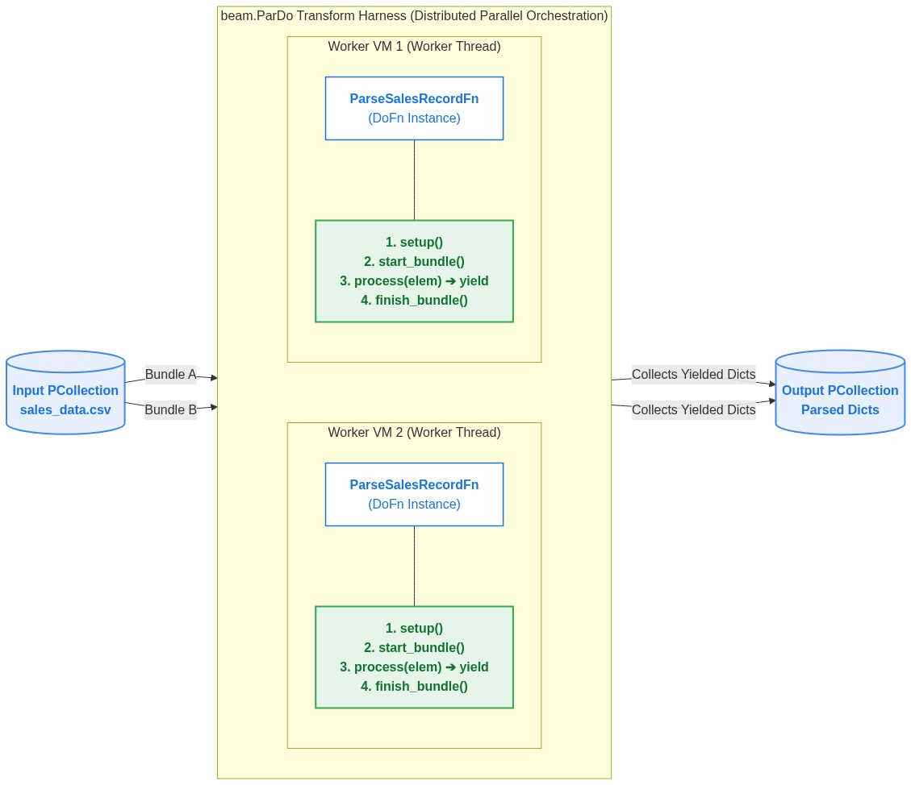
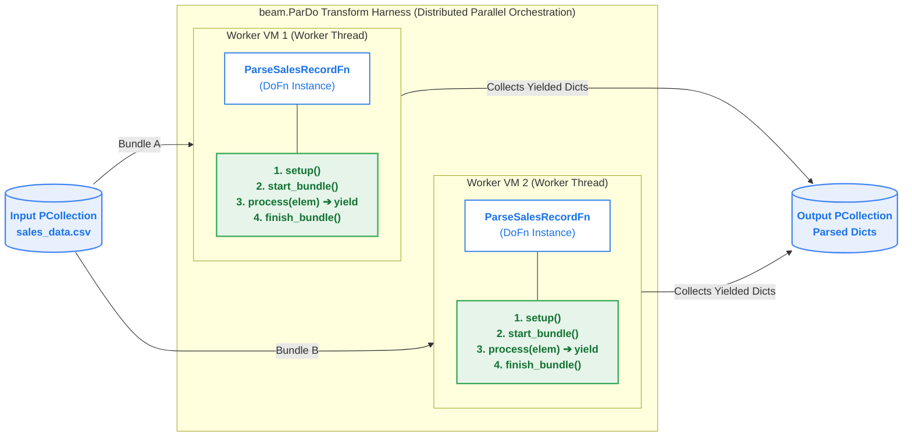

# Chapter 01 — Apache Beam & Dataflow Fundamentals

## Table of Contents

- [Overview](#overview)

- [Real-World Production Problem & Storyline](#real-world-production-problem--storyline)
- [Chapter Contents](#chapter-contents)
- [Pipeline Architecture & DAG Syntax](#pipeline-architecture--dag-syntax)
- [Core Concepts Deep Dive: DoFn vs. beam.ParDo](#core-concepts-deep-dive-dofn-vs-beam-pardo)

- [Environment Setup & Activating the Kernel](#environment-setup--activating-the-kernel)
- [Quick Start: Running the Pipeline](#quick-start-running-the-pipeline)
- [Official Documentation & Deep Dives](#official-documentation--deep-dives)

---

## Overview

In this chapter, we introduce the core concepts of the **Apache Beam** unified programming model and explore how **Google Cloud Dataflow** executes Beam pipelines at scale. 

You will build your first data pipeline processing the **Retail Sales** dataset (`sales_data.csv`), test it locally using **`DirectRunner`**, and submit it to Google Cloud's serverless infrastructure using **`DataflowRunner`**.

---

### What You Will Learn

1. **The Apache Beam Philosophy**:
   * How Beam unifies **Batch** and **Streaming** into a single API.
   * The separation between pipeline authoring (Beam SDK) and pipeline execution (Runners).
2. **Core Abstractions**:
   * **`Pipeline`**: The directed graph managing execution flow and configuration.
   * **`PCollection`**: Immutable distributed datasets (bounded or unbounded).
   * **`PTransform`**: In Apache Beam Python, a `PTransform` represents an operation (a step in your directed acyclic graph, or DAG) that takes one or more `PCollections` as input, performs work, and produces zero or more `PCollections` as output.`[Output PCollection] = [Input PCollection] | [Transform Label] >> [PTransform]`. The pipe syntax (`|`) is Python operator overloading at work to make writing and visualizing pipelines intuitive and readable. 
   * **`DoFn` / `beam.ParDo`**: User-defined element-wise transformation functions. In Apache Beam, a `DoFn` is the user-defined logic specifying what to do with each element, while `ParDo` is the pipeline transform (`PTransform`) that executes that logic in parallel across a `PCollection`.
   * **`CombinePerKey`**: Associative and commutative aggregations with partial local combine.
3. **Execution Environments (Runners)**:
   * **`DirectRunner`**: Local execution for fast iteration, debugging, and unit tests without cloud costs.
   * **`DataflowRunner`**: Managed distributed execution on Google Cloud with auto-scaling and dynamic work rebalancing.

---

## Real-World Production Problem & Storyline

### The Scenario: The Midnight Batch Breakdown
OmniRetail operates 500 retail stores nationwide. Every midnight, cash registers dump raw CSV transaction logs into Google Cloud Storage (`data/sales_data.csv`). The CFO and finance leadership require an aggregated daily revenue report by product category by 6:00 AM for morning inventory restocking and supplier settlements.

### The Production Disaster (Without Apache Beam)
Previously, the engineering team executed a single-node Python script using pandas on a Compute Engine VM. As business volume scaled to tens of millions of transactions:
1. **The `MemoryError` Wall**: Loading multi-gigabyte CSV files into pandas DataFrames consumed all VM RAM, crashing with unhandled Out-Of-Memory (OOM) errors at 3:30 AM.
2. **Zero Fault Tolerance**: When a 3-hour job fails at 90% completion, all intermediate progress is lost and the entire job must restart from scratch, guaranteeing a missed 6:00 AM SLA.
3. **No Elastic Scaling**: Scaling up required provisioning a massive `m2-ultramem` instance that sat idle for 20 hours a day, inflating cloud bills.

### How This Chapter's Demo Solves It
We replace the fragile single-node script with a distributed **Apache Beam** batch pipeline:
- **`beam.io.ReadFromText`**: Reads *massive files in parallel chunks* without exhausting worker memory.
- **Custom `DoFn` (`ParseSalesRecordFn`, `FilterByDateFn`)**: `DoFn`is a base Python class, used to define user-defined logic specifying what to do with each element. In this case, `ParseSalesRecordFn(beam.DoFn` parses records into typed dictionaries and `FilterByDateFn(beam.DoFn)` filters out records outside of a specified date range.
- **`CombinePerKey(sum)`**: a core transform that aggregates all values associated with each key in a keyed PCollection (i.e., a collection of (key, value) pairs) using an associative and commutative combining function.Executes partial combiner aggregation locally on worker VMs before distributed shuffle, slashing network transfer.
- **Run Anywhere**: Developers test locally on workstation sample data with **`DirectRunner`**, then deploy to **`DataflowRunner`** where Google Cloud provisions, balances, and tears down worker VMs automatically.

### Storyline Connection
- ➡️ **Next Crisis (Chapter 02)**: Batch scaling is solved, but marketing introduces an auxiliary product dimension catalog, and cash register glitches inject corrupt records with negative subtotals that silently crash the nightly run!

---

## Chapter Contents

| File / Directory | Description |
| :--- | :--- |
| [`01_beam_fundamentals.ipynb`](./01_beam_fundamentals.ipynb) | Interactive Jupyter notebook walking step-by-step through Beam fundamentals, transforms, and execution. |
| [`data/sales_data.csv`](./data/sales_data.csv) | Sample retail transactions dataset (`transaction_id, product_id, amount, transaction_date`). |
| [`pipelines/sales_pipeline.py`](./pipelines/sales_pipeline.py) | Modular, production-ready Beam pipeline script runnable with `DirectRunner` or `DataflowRunner`. |
| [`scripts/01_run_local.sh`](./scripts/01_run_local.sh) | Shell script to execute the pipeline locally using `uv` and `DirectRunner`. |
| [`scripts/02_run_dataflow.sh`](./scripts/02_run_dataflow.sh) | Shell script to upload data to GCS and launch the job on Google Cloud Dataflow. |

---

## Pipeline Architecture & DAG Syntax

In Apache Beam, pipelines are constructed using the pipe operator (`|`) and the right-shift operator (`>>`):
```python
[Output PCollection] = [Input PCollection] | "Unique Transform Name" >> [PTransform]
```

### Visual Shape Legend
* **🛢️ `[( PCollection )]` (Cylinder / Oval)**: Represents immutable distributed **data** (in-flight records).
* **⚙️ `[ PTransform ]` (Rectangle)**: Represents the **processing operations** that consume and produce `PCollections`.

### What Does the "Unique Transform Name" Stand For?
In `p | "FilterDate" >> beam.ParDo(...)`, the string `"FilterDate"` is a critical runtime identifier:
1. **DAG Graph Node Label**: Apache Beam registers this string as the unique node identifier in the execution DAG.
2. **Google Cloud Dataflow Console Stage**: The GCP Console visualizes each pipeline step using this label, allowing you to click on stages to inspect worker throughput, execution latency, and bottlenecks.
3. **Cloud Monitoring & Logging Scope**: All Dataflow metrics (counters, execution wall time, CPU utilization) are indexed by this step name in Cloud Monitoring.
4. **Uniqueness Constraint**: Every transform name **must be unique** within its scope. Reusing a name raises `ValueError: A transform with name ... already exists in this pipeline`.
5. **Streaming Checkpoints**: For streaming jobs, Dataflow keys window buffers and timers to these names. Preserving names ensures state continuity during rolling pipeline updates (`--update`).

```mermaid
flowchart LR
    classDef pcoll fill:#e8f0fe,stroke:#4285f4,stroke-width:2px,color:#1a73e8,font-weight:bold;
    classDef ptrans fill:#fef7e0,stroke:#f9ab00,stroke-width:2px,color:#b06000,font-weight:bold;

    subgraph S1["1. Ingestion"]
        RAW[("sales_data.csv")]:::pcoll
        T_READ["'ReadCSV'<br/><i>ReadFromText</i>"]:::ptrans
        PC_RAW[("Raw Lines")]:::pcoll
        RAW --> T_READ --> PC_RAW
    end

    subgraph S2["2. Parse & Filter"]
        T_PARSE["'ParseRecords'<br/><i>ParseSalesRecordFn</i>"]:::ptrans
        PC_PARSED[("Parsed Dicts")]:::pcoll
        T_FILTER["'FilterDate'<br/><i>FilterByDateFn</i>"]:::ptrans
        PC_FILTERED[("Target Date")]:::pcoll
        T_PARSE --> PC_PARSED --> T_FILTER --> PC_FILTERED
    end

    subgraph S3["3. Aggregate"]
        T_MAP["'ExtractProductAmount'<br/><i>Map(extract_kv)</i>"]:::ptrans
        PC_KV[("(product_id, amount)")]:::pcoll
        T_COMBINE["'AggregateRevenue'<br/><i>CombinePerKey(sum)</i>"]:::ptrans
        PC_AGG[("(product_id, total)")]:::pcoll
        T_MAP --> PC_KV --> T_COMBINE --> PC_AGG
    end

    subgraph S4["4. Format & Sink"]
        T_FORMAT["'FormatOutput'<br/><i>Map(format_output)</i>"]:::ptrans
        PC_STR[("Formatted Strings")]:::pcoll
        T_WRITE["'WriteResults'<br/><i>WriteToText</i>"]:::ptrans
        OUT[("revenue_summary-*.txt")]:::pcoll
        T_FORMAT --> PC_STR --> T_WRITE --> OUT
    end

    PC_RAW --> T_PARSE
    PC_FILTERED --> T_MAP
    PC_AGG --> T_FORMAT
```

<!--  -->



---

## Core Concepts Deep Dive: DoFn vs. beam.ParDo

In Apache Beam, `DoFn` and `beam.ParDo` represent the two halves of parallel data processing. Confusing these two concepts is the single most common pitfall for developers new to distributed pipelines.

### The Core Distinction: Logic vs. Execution Harness

| Concept | What It Is | Primary Role |
| :--- | :--- | :--- |
| **`beam.DoFn`** | A Python **class** (subclass of `beam.DoFn`) | **The Business Logic ("What")**: Defines how to transform an *individual element*. It contains your custom algorithms, data validation, and parsing routines. |
| **`beam.ParDo`** | A Beam **PTransform** (subclass of `beam.PTransform`) | **The Execution Harness ("How")**: Defines how to execute that logic in *parallel across a cluster*. It handles bundle chunking, thread scheduling, worker dispatch, and collection aggregation. |

> [!TIP]
> **The Factory Analogy**:
> * Think of **`beam.ParDo`** as the **automated assembly line conveyor belt** with robotic arms spanning across factory workstations.
> * Think of **`DoFn`** as the **toolhead and software recipe** loaded into each robotic arm.
> * A recipe cannot assemble parts on its own without the conveyor line (`pcoll | MyDoFn()` raises a `TypeError`).
> * A conveyor line without a toolhead has nothing to execute.
> * When combined (`pcoll | beam.ParDo(MyDoFn())`), raw components are fed onto the conveyor, distributed across robotic stations, processed concurrently, and aggregated into finished products.

---

### How They Work Together: Distributed Execution Lifecycle

When you submit a pipeline to Google Cloud Dataflow, `beam.ParDo` and your `DoFn` collaborate through a strict 6-phase distributed lifecycle:

1. **Pipeline Construction & Graph Serialization (Driver Machine)**:
   - On your local development machine, you define `pcoll | "Parse" >> beam.ParDo(ParseSalesRecordFn())`.
   - Apache Beam uses `dill`/`pickle` to serialize the `DoFn` instance and transmits its bytecode to the Dataflow service.
2. **Worker Instantiation & `setup()`**:
   - Dataflow provisions worker VMs and launches worker processes/threads.
   - Each worker deserializes `ParseSalesRecordFn` and calls **`setup()`** once per worker instance. This is where you initialize heavy, non-element-specific dependencies (such as compiling regex patterns or initializing connection pools).
3. **Bundle Slicing & `start_bundle()`**:
   - A `PCollection` containing millions of records is divided by `beam.ParDo` into chunks called **bundles** (e.g., 5,000 records).
   - Before feeding elements of a bundle to the worker, `beam.ParDo` invokes **`start_bundle()`**, allowing initialization of bundle-level buffers or accumulators.
4. **Per-Element Parallel Execution & `process()`**:
   - `beam.ParDo` loops through the bundle elements, calling **`process(self, element, *args, **kwargs)`** for each record.
   - Inside `process()`, you use `yield` (a Python generator). This gives you total cardinality flexibility:
     - **0 outputs (`yield` nothing)**: Drops/filters records (e.g., `FilterByDateFn`).
     - **1 output (`yield record`)**: 1-to-1 transformation or parsing (e.g., `ParseSalesRecordFn`).
     - **N outputs (multiple `yield` calls)**: 1-to-N splitting, flattening, or tokenization.
5. **Bundle Finalization & `finish_bundle()`**:
   - Once all records in the bundle are processed, `beam.ParDo` invokes **`finish_bundle()`**. If you buffered records in memory, you flush them here before the worker commits the bundle checkpoint to Dataflow.
6. **Worker Teardown & `teardown()`**:
   - When the pipeline completes or worker VMs autoscale down, `beam.ParDo` invokes **`teardown()`** to cleanly close network sockets and resources.

---

### Architecture & Execution Flow Diagram

The diagram below illustrates how `beam.ParDo` acts as the distributed execution harness, orchestrating worker VMs and calling the `DoFn` lifecycle across parallel bundles:



<details>
<summary><b>View Mermaid Source Code</b></summary>



</details>

---

### Comparison Matrix: DoFn vs. beam.ParDo

| Dimension | `beam.DoFn` | `beam.ParDo` |
| :--- | :--- | :--- |
| **Object Type** | Subclass of `beam.DoFn` (Python class) | Subclass of `beam.PTransform` (Beam transform) |
| **Input** | A single element (`element`) | A distributed collection (`PCollection[A]`) |
| **Output** | An iterable of zero or more elements (`yield`) | A new distributed collection (`PCollection[B]`) |
| **Invocation Syntax** | Passed as an argument: `beam.ParDo(MyDoFn())` | Applied with pipe operator: `pcoll \| "Name" >> beam.ParDo(...)` |
| **Where Code Runs** | On worker VMs inside worker threads | Orchestrated by the runner (Dataflow / DirectRunner) |
| **Lifecycle Hooks** | `setup()`, `start_bundle()`, `process()`, `finish_bundle()`, `teardown()` | Controls when lifecycle hooks are invoked on workers |
| **State & Timers** | Declares state specs (`@StateId`) and timers (`@TimerId`) | Manages state persistence and timer delivery via Streaming Engine |

---

### Common Anti-Patterns & Pitfalls

#### ❌ Anti-Pattern 1: Applying DoFn directly to a PCollection
```python
# WRONG: Raises TypeError (DoFn is not a PTransform!)
parsed = lines | ParseSalesRecordFn()

# CORRECT: Wrap DoFn inside beam.ParDo
parsed = lines | "ParseRecords" >> beam.ParDo(ParseSalesRecordFn())
```

#### ❌ Anti-Pattern 2: Using `return` instead of `yield` in `process()`
```python
# WRONG: Returning a string treats it as an iterable of characters!
class ParseFn(beam.DoFn):
    def process(self, line):
        return line.strip()  # Emits each character ("a", "b", "c"...) as separate elements!

# CORRECT: Use yield to emit complete objects or tuples
class ParseFn(beam.DoFn):
    def process(self, line):
        yield line.strip()   # Emits the complete stripped string
```

#### ❌ Anti-Pattern 3: Opening network connections inside `process()`
```python
# WRONG: Opens a new database/HTTP connection for EVERY single record!
# 1,000,000 records = 1,000,000 connection attempts -> socket exhaustion & crashes!
class QueryCatalogFn(beam.DoFn):
    def process(self, element):
        client = db.connect()  # SEVERE PERFORMANCE BOTTLENECK
        yield client.lookup(element["product_id"])

# CORRECT: Open client ONCE per worker in setup(), reuse across elements
class QueryCatalogFn(beam.DoFn):
    def setup(self):
        self.client = db.connect()  # Called once per worker process!

    def process(self, element):
        yield self.client.lookup(element["product_id"])

    def teardown(self):
        self.client.close()
```

#### ❌ Anti-Pattern 4: Shared mutable class state across workers
```python
# WRONG: Python class variables are NOT shared across distributed worker VMs!
class BadCounterFn(beam.DoFn):
    total_count = 0  # Each worker VM has its own isolated memory space

    def process(self, element):
        BadCounterFn.total_count += 1  # Total count will be completely inaccurate!
        yield element

# CORRECT: Use Beam Combiners (CombinePerKey, beam.combiners.Count) or Chapter 04 Stateful DoFns!
```

---

## Environment Setup & Activating the Kernel

Before running scripts or opening the notebook, set up the project environment (for the complete guide, see the root [README.md](../README.md#environment-setup--activating-the-kernel-with-uv)):

```bash
# 1. From the repository root, install dependencies into .venv
uv sync

# 2. Activate the virtual environment in your terminal (optional, if running commands directly)
source .venv/bin/activate

# 3. Register the .venv as a Jupyter kernel (prevents ModuleNotFoundError in notebooks)
uv run python -m ipykernel install --user --name dataflow-workshops --display-name "Python (dataflow-workshops)"
```

When opening [`01_beam_fundamentals.ipynb`](./01_beam_fundamentals.ipynb), click the **Kernel Picker** in the top-right corner of your IDE and select **`Python (dataflow-workshops)`** (or `.venv/bin/python`).

---

## Quick Start: Running the Pipeline

### 1. Run Locally with DirectRunner
Verify pipeline logic on your local machine in seconds:
```bash
bash 01_beam_fundamentals/scripts/01_run_local.sh
```
Expected output:
```text
product_id=PROD_A, total_revenue=275.74
product_id=PROD_B, total_revenue=510.25
product_id=PROD_C, total_revenue=300.50
```

### 2. Run on Google Cloud Dataflow
Ensure you have configured your `.env` file with `GCP_PROJECT_ID` and `DATAFLOW_BUCKET`, then run:
```bash
bash 01_beam_fundamentals/scripts/02_run_dataflow.sh
```
This script:
1. Uploads `data/sales_data.csv` to `gs://${DATAFLOW_BUCKET}/data/sales_data.csv`.
2. Submits the job to Dataflow with `--runner=DataflowRunner`.
3. Returns a direct link to monitor the job execution graph, worker scaling, and throughput in the Google Cloud Console.

---

## Official Documentation & Deep Dives

* [Apache Beam Programming Guide](https://beam.apache.org/documentation/programming-guide/) — Comprehensive guide to the Apache Beam unified batch and streaming programming model.
* [Apache Beam Python SDK Quickstart](https://beam.apache.org/get-started/quickstart-py/) — Official getting started guide for Python Beam.
* [Google Cloud Dataflow Documentation](https://cloud.google.com/dataflow/docs) — Full documentation for Google Cloud's fully-managed serverless data processing service.
* [Apache Beam DirectRunner Guide](https://beam.apache.org/documentation/runners/direct/) — Local pipeline execution and debugging guide.
* [Google Cloud Dataflow Runner Guide](https://beam.apache.org/documentation/runners/dataflow/) — Deploying Beam pipelines on Cloud Dataflow.
* [Dataflow Troubleshooting & Best Practices](https://cloud.google.com/dataflow/docs/guides/common-troubleshooting-techniques) — Identifying pipeline bottlenecks, worker logs, and common pitfalls.

