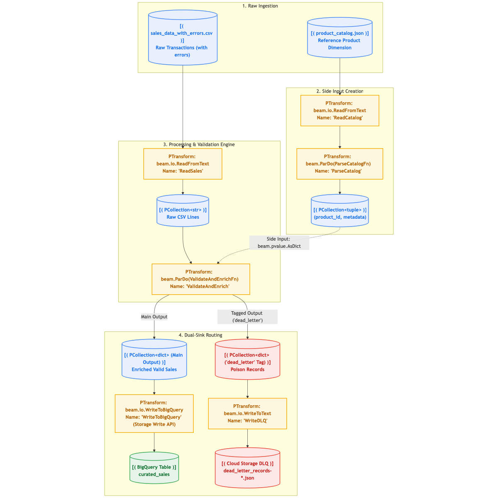
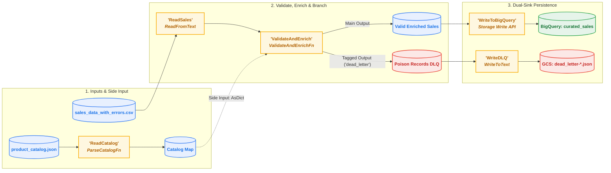

# Chapter 02 — Advanced Transforms, Side Inputs & BigQuery I/O

## Table of Contents

- [Overview](#overview)
- [Real-World Production Problem & Storyline](#real-world-production-problem--storyline)
- [Pipeline Architecture & DAG](#pipeline-architecture--dag)
- [Core Concepts Deep Dive](#core-concepts-deep-dive)
  - [1. `DoFn` Lifecycle Methods](#1-dofn-lifecycle-methods)
  - [2. Side Inputs (`beam.pvalue.AsDict`)](#2-side-inputs-beampvalueasdict)
  - [3. Tagged Multi-Outputs & Dead-Letter Queues (DLQ)](#3-tagged-multi-outputs--dead-letter-queues-dlq)
  - [4. BigQuery Storage Write API](#4-bigquery-storage-write-api)
- [Chapter Contents](#chapter-contents)
- [Environment Setup & Activating the Kernel](#environment-setup--activating-the-kernel)
- [Quick Start: Running the Pipeline](#quick-start-running-the-pipeline)
  - [1. Run Locally with DirectRunner](#1-run-locally-with-directrunner)
  - [2. Deploy to Google Cloud Dataflow & BigQuery](#2-deploy-to-google-cloud-dataflow--bigquery)
- [Official Documentation & Deep Dives](#official-documentation--deep-dives)

---

## Overview

In production data engineering, raw inputs are rarely clean, and business logic often requires enriching in-flight records against dimension tables (such as product catalogs, customer tiers, or currency exchange rates). Furthermore, a single corrupt or unparseable record must never halt a 24/7 mission-critical pipeline or be silently discarded.

In this chapter, you will master advanced **Apache Beam** patterns and deploy a robust data validation and enrichment engine to **Google Cloud Dataflow** and **BigQuery**:

1. **`DoFn` Lifecycle Methods**: Optimizing worker resource initialization (`setup`, `process`, `teardown`).
2. **Side Inputs (`beam.pvalue.AsDict`)**: Broadcasting reference lookup data without expensive distributed shuffles.
3. **Tagged Multi-Outputs & Dead-Letter Queues (DLQ)**: Branching records into clean data vs. poison records using `beam.pvalue.TaggedOutput`.
4. **Google Cloud BigQuery Storage Write API**: High-throughput, cost-effective, exactly-once ingestion into BigQuery tables with automated schema creation.

---

## Pipeline Architecture & DAG

The pipeline ingests raw transactions containing both valid and intentionally corrupted records (`sales_data_with_errors.csv`) alongside a product dimension catalog (`product_catalog.json`). Clean records are enriched and written to **BigQuery**, while poison records are captured in a **Cloud Storage Dead-Letter Queue**:



<details>
<summary><b>Click to expand raw Mermaid flowchart definition</b></summary>


</details>

---

## Core Concepts Deep Dive

### 1. `DoFn` Lifecycle Methods

In distributed runtimes like Dataflow, worker VMs run multiple processing threads. Understanding the `DoFn` lifecycle prevents severe performance bottlenecks:

| Method | Invocation Frequency | Best Used For | Anti-Pattern to Avoid |
| :--- | :--- | :--- | :--- |
| **`setup(self)`** | Once per worker instance upon initialization | Compiling regexes, opening database connections, initializing ML model weights | Never perform per-element logic here |
| **`start_bundle(self)`** | Once before processing a batch of elements | Opening temporary in-memory buffers or local accumulators | Heavy remote API calls |
| **`process(self, element)`** | Once for every single incoming record | Applying transformations, yields elements | **Never open network sockets or database connections here!** |
| **`finish_bundle(self)`** | Once after processing a batch of elements | Flushing buffered writes | Blocking indefinitely |
| **`teardown(self)`** | Once when worker shuts down | Closing database connections, client cleanups | Emitting data |

### 2. Side Inputs (`beam.pvalue.AsDict`)

When you need to join a massive main stream (`PCollection`) with a reference dimension table (like `product_catalog.json`):
* Performing a distributed `CoGroupByKey` forces Dataflow to shuffle both collections across the entire network—consuming massive network bandwidth and disk I/O.
* A **Side Input** broadcasts the smaller reference collection to worker memory. Each worker receives the lookup table as an in-memory dictionary (`beam.pvalue.AsDict`) accessible in $O(1)$ time inside the `process()` method:

```python
# Pass catalog PCollection as a dictionary side input to ParDo
results = sales_pcoll | "Enrich" >> beam.ParDo(
    ValidateAndEnrichFn(),
    catalog=beam.pvalue.AsDict(catalog_pcoll)
)
```

### 3. Tagged Multi-Outputs & Dead-Letter Queues (DLQ)

In a standard transform, `yield element` emits to the default `PCollection`. Using `beam.pvalue.TaggedOutput`, you can branch execution into multiple streams based on data quality:

```python
# Route valid records to default stream, poison records to 'dead_letter'
if is_valid(element):
    yield enriched_element
else:
    yield beam.pvalue.TaggedOutput("dead_letter", {
        "raw_line": element,
        "error_reason": "Missing product_id",
        "timestamp": now()
    })
```

You then unpack the outputs using `.with_outputs("dead_letter", main="valid_sales")` and attach distinct sinks to each stream!

### 4. BigQuery Storage Write API

Dataflow's `beam.io.WriteToBigQuery` supports modern high-performance ingestion:
* **`Method.STORAGE_WRITE_API`**: Uses Google Cloud's gRPC-based BigQuery Storage Write API.
* **Cost Efficiency**: Eliminates legacy streaming insert costs ($0.05 per GB) while achieving significantly higher throughput.
* **Schema Handling**: Setting `create_disposition=CREATE_IF_NEEDED` automatically provisions the BigQuery dataset and table schema if it does not already exist.

---

## Real-World Production Problem & Storyline

### The Scenario: Dimension Enrichment & Corrupt POS Payloads
OmniRetail's finance team now requires every transaction to be enriched with category metadata and wholesale costs from a reference product dimension (`data/product_catalog.json`). Meanwhile, legacy cash register firmware updates begin emitting corrupted payloads: negative subtotals (`amount: -45.00`), missing product IDs, and unparseable dates.

### The Production Disaster (Without Side Inputs & Dead-Letter Queues)
1. **The Join Shuffle Explosion**: Joining transactions with the catalog using standard `CoGroupByKey` forces Dataflow to hash and shuffle both datasets across the network, multiplying execution time and network egress costs by 5x.
2. **The "Poison Pill" Pipeline Crash**: When a worker encounters `subtotal: -45.00` or an unparseable date, Python throws an unhandled exception. Dataflow retries the bundle 4 times before terminating the entire 4-hour batch pipeline with `Workflow failed`.
3. **The Unacceptable Alternative (Silent Dropping)**: Silently ignoring errors in a `try/except: pass` block leads to audit failure because corrupt transactions vanish from financial accounting without a trace.

### How This Chapter's Demo Solves It
We implement production-grade validation and enrichment patterns:
- **Side Inputs (`beam.pvalue.AsDict`)**: Broadcasts the reference catalog to all workers as an in-memory dictionary. Workers perform instant $O(1)$ lookups with zero cross-network join shuffles.
- **Tagged Multi-Outputs (`TaggedOutput`)**: Branches records cleanly: valid rows go to the main stream, while corrupt rows are tagged into `dead_letter`.
- **Dual-Sink Routing**: Valid enriched records stream into BigQuery using the high-performance **BigQuery Storage Write API**, while quarantined poison pills are written to Cloud Storage (`dead_letter_records-*.json`) for immediate triage.

### Storyline Connection
- ⬅️ **Previously (Chapter 01)**: Built distributed batch pipelines with Beam fundamentals.
- ➡️ **Next Crisis (Chapter 03)**: Black Friday flash sales hit. Waiting 24 hours for midnight batch files means fraudulent bot rings drain sneaker inventory before alerts trigger. We must pivot to real-time streaming!

---

## Chapter Contents

| File / Directory | Description |
| :--- | :--- |
| [`02_transforms_and_bigquery.ipynb`](./02_transforms_and_bigquery.ipynb) | Interactive Jupyter notebook demonstrating `DoFn` lifecycle, Side Inputs, DLQs, and BigQuery loading. |
| [`data/sales_data_with_errors.csv`](./data/sales_data_with_errors.csv) | Sales dataset with valid transactions + intentional poison rows (negative amounts, missing IDs, bad dates). |
| [`data/product_catalog.json`](./data/product_catalog.json) | Product dimension catalog with metadata (`product_name`, `category`, `unit_cost`) used for Side Input lookup. |
| [`pipelines/enrich_and_load_bq.py`](./pipelines/enrich_and_load_bq.py) | Production-ready pipeline script supporting local JSON sinks and BigQuery Storage Write API sinks. |
| [`scripts/01_run_local.sh`](./scripts/01_run_local.sh) | Local execution script (`DirectRunner`) verifying Side Input enrichment and dead-letter queue routing. |
| [`scripts/02_run_dataflow.sh`](./scripts/02_run_dataflow.sh) | Cloud submission script (`DataflowRunner`) loading clean data into BigQuery and errors into Cloud Storage DLQ. |

---

## Environment Setup & Activating the Kernel

Before executing scripts or running notebook cells, activate the environment (for the complete guide, see the root [README.md](../README.md#environment-setup--activating-the-kernel-with-uv)):

```bash
# 1. From repository root, install dependencies into .venv
uv sync

# 2. Activate virtual environment in terminal
source .venv/bin/activate

# 3. Register Jupyter kernel (if not already done)
uv run python -m ipykernel install --user --name dataflow-workshops --display-name "Python (dataflow-workshops)"
```

In [`02_transforms_and_bigquery.ipynb`](./02_transforms_and_bigquery.ipynb), select **`Python (dataflow-workshops)`** from the top-right Kernel Picker.

---

## Quick Start: Running the Pipeline

### 1. Run Locally with DirectRunner
Test the validation rules, Side Input lookups, and Dead-Letter branching locally:
```bash
bash 02_transforms_and_bigquery/scripts/01_run_local.sh
```

**Output Breakdown**:
* **`output/valid_sales-*.json`**: 6 clean transactions enriched with product metadata and computed profit margins.
* **`output/dead_letter_records-*.json`**: 4 poison transactions tagged with exact root causes:
  1. `Product 'PROD_UNKNOWN' not found in catalog`
  2. `Non-positive amount: -50.0`
  3. `Invalid date format 'INVALID_DATE' (must be YYYY-MM-DD)`
  4. `Missing product_id`

### 2. Deploy to Google Cloud Dataflow & BigQuery
Ensure `.env` contains your `GCP_PROJECT_ID` and `DATAFLOW_BUCKET`, then run:
```bash
bash 02_transforms_and_bigquery/scripts/02_run_dataflow.sh
```

The script will:
1. Ensure the BigQuery dataset (`dataflow_workshop`) exists.
2. Upload `sales_data_with_errors.csv` and `product_catalog.json` to your Cloud Storage bucket.
3. Submit the pipeline to Dataflow with `--runner=DataflowRunner`.
4. Stream enriched valid rows directly into BigQuery table `curated_sales` via the **Storage Write API**.
5. Save poison records into `gs://${DATAFLOW_BUCKET}/dlq/dead_letter_records-*.json`.

---

## Official Documentation & Deep Dives

* [Apache Beam DoFn Lifecycle](https://beam.apache.org/documentation/programming-guide/#dofn) — Understanding worker setup, bundle processing, and teardown execution.
* [Apache Beam Side Inputs Guide](https://beam.apache.org/documentation/programming-guide/#side-inputs) — Broadcasting reference collections and dictionaries to worker threads.
* [Apache Beam Additional Outputs (Branching Streams)](https://beam.apache.org/documentation/programming-guide/#additional-outputs) — Dead-letter queues and multi-output routing.
* [Apache Beam BigQuery I/O Connector](https://beam.apache.org/documentation/io/built-in/google-bigquery/) — Configuring BigQuery Storage Read and Storage Write APIs.
* [Google Cloud BigQuery Storage Write API](https://cloud.google.com/bigquery/docs/write-api) — High-throughput streaming ingestion with exactly-once delivery semantics.

