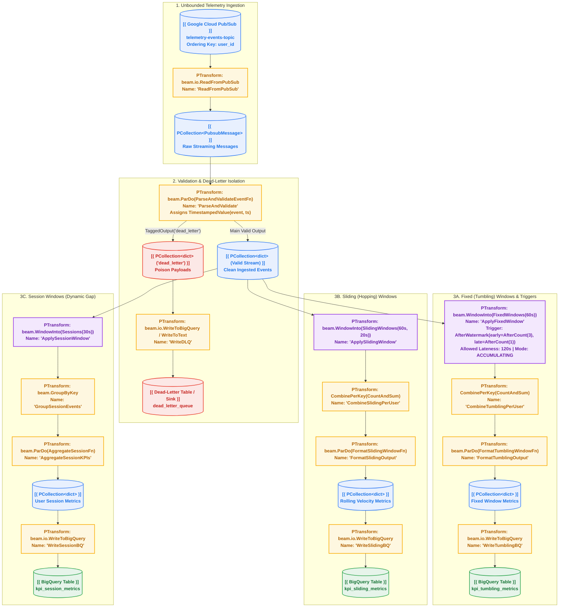

# Chapter 03 — Real-Time Streaming, Windowing & Late Data

[](https://beam.apache.org/)
[](https://cloud.google.com/dataflow)
[](https://cloud.google.com/pubsub)
[](https://cloud.google.com/bigquery)
[](https://www.python.org/)

In real-world data engineering, data arrives continuously, out-of-order, and unpredictably. Batch processing paradigms fail when downstream decision systems require real-time velocity metrics, active session tracking, and continuous fraud detection.

This chapter covers the theoretical and operational foundations of **unbounded stream processing** using Apache Beam and Google Cloud Dataflow. You will build a multi-branch streaming pipeline that ingests event streams from **Google Cloud Pub/Sub**, extracts event-time timestamps, handles out-of-order and late-arriving records, and computes three distinct temporal aggregations simultaneously.

---

## Architecture Overview

The pipeline ingests unbounded e-commerce telemetry, isolates poison records into a Dead-Letter Queue, and fans out valid events into three parallel windowing topologies:


<details>
<summary><b>View Mermaid Source Code</b></summary>


</details>

---

## Core Streaming Concepts: The 4 Questions

Stream processing in Apache Beam is governed by Tyler Akidau’s foundational model answering four questions:

| Question | Beam Primitive | Meaning |
| :--- | :--- | :--- |
| **1. What is being computed?** | `beam.ParDo`, `CombinePerKey` | Transformations, filters, and mathematical aggregations (e.g. sum, count, average). |
| **2. Where in event-time is it computed?** | `beam.WindowInto(WindowFn)` | Temporal partitioning: Fixed, Sliding, or Session Windows. |
| **3. When in processing-time are results materialized?** | `trigger.TriggerFn` | The Watermark, speculative early triggers, and late firing conditions. |
| **4. How do results relate?** | `AccumulationMode` | `ACCUMULATING` (overwriting with cumulative totals) vs `DISCARDING` (emitting delta differences). |

---

## Event Time vs. Processing Time

1. **Event Time ($t_E$)**: The exact instant an event occurred on the source device or client (e.g. mobile app click, IoT sensor reading). Embedded in the payload.
2. **Ingestion Time ($t_I$)**: The instant Google Cloud Pub/Sub received and acknowledged the message.
3. **Processing Time ($t_P$)**: The clock time on the Dataflow worker VM currently executing the transformation.

```text
[Device Click]  ──────>  [Pub/Sub Ingestion]  ──────>  [Dataflow Worker]
  Event Time               Ingestion Time               Processing Time
 10:00:05 UTC               10:00:18 UTC                 10:00:22 UTC
```

Due to network latency, offline mobile apps, and retry loops, event time and processing time diverge. **A correct streaming pipeline must ALWAYS partition data by Event Time, never by processing time.**

---

## The Three Windowing Topologies

### 1. Fixed (Tumbling) Windows
Non-overlapping, fixed-duration time intervals (e.g., 60-second intervals):
- `[10:00:00 - 10:01:00)`, `[10:01:00 - 10:02:00)`
- Each element belongs to exactly **one** window.
- Perfect for standard periodic financial and operational metric rollups.

### 2. Sliding (Hopping) Windows
Overlapping time intervals defined by **Duration** and **Slide Period** (e.g., 60s window, sliding every 20s):
- `[09:59:40 - 10:00:40)`, `[10:00:00 - 10:01:00)`, `[10:00:20 - 10:01:20)`
- Each element belongs to **multiple** windows simultaneously (`Duration / Period` windows).
- Used for moving averages, velocity checks, and high-frequency spike detection.

### 3. Session Windows
Data-driven windows defined by a **gap of inactivity** (e.g., 30s inactivity timeout):
- Windows dynamically expand and merge as events arrive for a given key (`user_id`).
- When a user ceases activity for > 30 seconds, their session closes.
- Essential for web analytics, user funnel drop-off analysis, and clickstream sessionization.

---

## Watermarks, Allowed Lateness & Triggers

### What is a Watermark?
A **Watermark** is a monotonically increasing timestamp representing the system's estimate of event-time completeness. When the watermark reaches timestamp $T$, the pipeline assumes that all data with event time $t \le T$ has already been processed.

### Handling Late Data
Network delays cause records to arrive after the watermark has already advanced past the end of their window.
Beam provides two controls:
1. **Allowed Lateness (`allowed_lateness`)**: A grace period (e.g., 2 minutes) during which windows remain open in state memory. Late elements arriving within this window are processed; elements arriving after allowed lateness are discarded.
2. **Triggers (`AfterWatermark`)**: Dictate when window panes fire:
   - **Early Trigger (`early=AfterCount(3)`)**: Emits speculative preliminary results before the watermark closes the window.
   - **On-Time Trigger**: Emits when the watermark passes the end of the window.
   - **Late Trigger (`late=AfterCount(1)`)**: Emits an updated revision every time a late record arrives.

---

## Google Cloud Pub/Sub with Ordering Keys

Google Cloud Pub/Sub partitions messages using an **Ordering Key** (e.g., `user_id` or `device_id`).
When ordering keys are enabled:
- Messages published with the same ordering key are guaranteed to be delivered to subscribers in the exact order they were received by Pub/Sub.
- If a subscriber fails to acknowledge a message for a given key, subsequent messages for that key are held until the earlier message is acknowledged or times out.

---

## Chapter Directory Structure

```text
03_realtime_streaming/
├── README.md                                         # This documentation
├── 03_realtime_streaming.ipynb                       # Interactive notebook with runnable cells
├── data/
│   └── sample_events.json                            # Synthetic telemetry events (valid, late, poison)
├── pipelines/
│   └── streaming_windowing_pipeline.py               # Dual-runner streaming windowing pipeline
└── scripts/
    ├── generate_streaming_data.py                    # Pub/Sub & local streaming event generator
    ├── 01_run_local.sh                               # Local DirectRunner test script
    └── 02_run_dataflow.sh                            # Cloud DataflowRunner deployment script
```

---

## Step-by-Step Hands-On Guide

### Step 1: Activate the Environment

Ensure you are in the workshop root directory with your `uv` virtual environment active:

```bash
cd /Users/zelda.luconi/Medium/google-products/dataflow-workshops
source .venv/bin/activate
```

### Step 2: Run the Pipeline Locally (DirectRunner)

Execute the local runner script to run the multi-branch pipeline against synthetic streaming telemetry:

```bash
bash 03_realtime_streaming/scripts/01_run_local.sh
```

**Expected Local Output:**
1. `tumbling_metrics-*.json`: Aggregated spend and event count for each 60-second window per user.
2. `sliding_metrics-*.json`: Rolling 60s windows shifted every 20 seconds.
3. `session_metrics-*.json`: Session start, session end, duration, and metrics clustered by 30-second user inactivity gaps.
4. `dead_letters-*.json`: Poison records (negative amount, empty user ID, malformed JSON) tagged and isolated without pipeline crash!

### Step 3: Run the Streaming Generator (Optional Live Simulator)

To simulate continuous live event publishing to a GCP Pub/Sub topic:

```bash
uv run python 03_realtime_streaming/scripts/generate_streaming_data.py \
  --project="YOUR_PROJECT_ID" \
  --topic="telemetry-events-topic" \
  --rate=3.0 \
  --total-events=150 \
  --late-rate=0.15 \
  --poison-rate=0.10
```

### Step 4: Deploy to Google Cloud Dataflow

To deploy the production streaming pipeline with **Dataflow Streaming Engine** and **BigQuery Storage Write API**:

```bash
bash 03_realtime_streaming/scripts/02_run_dataflow.sh
```

Monitor your streaming job in the Cloud Console:
- **Dataflow Console**: Observe **System Lag** and **Data Freshness** metrics.
- **BigQuery Console**: Query `kpi_tumbling_metrics`, `kpi_sliding_metrics`, `kpi_session_metrics`, and `dead_letter_queue`.
