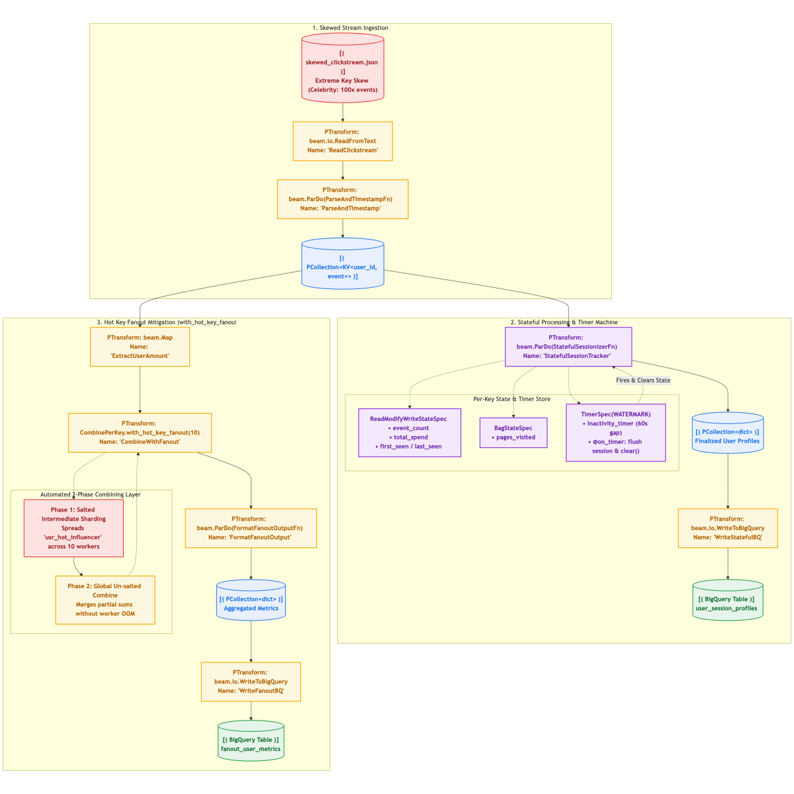
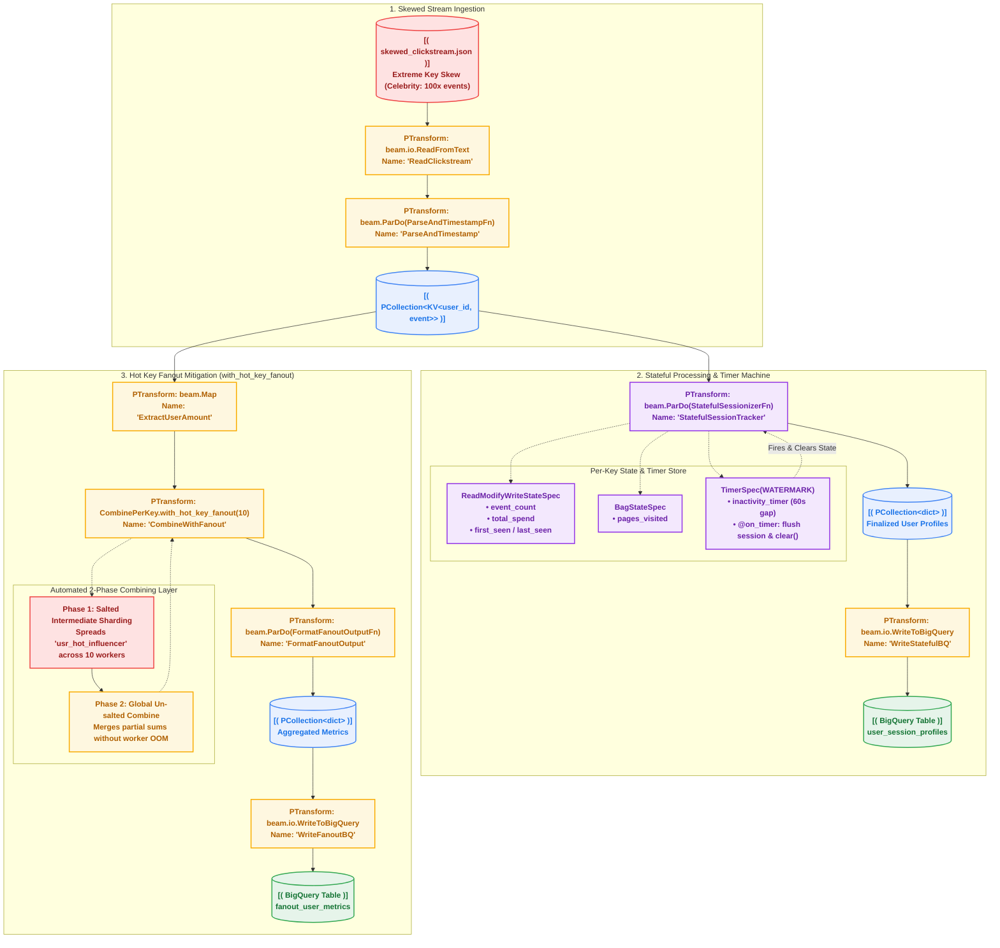

# Chapter 04 — Stateful Processing, Timers & Hot Key Fanout

[](https://beam.apache.org/)
[](https://cloud.google.com/dataflow)
[](https://cloud.google.com/bigquery)
[](https://www.python.org/)

In high-throughput stream processing, two critical operational hurdles routinely crash production data pipelines:
1. **The Hot Key Bottleneck (Data Skew)**: A single entity (e.g., a viral celebrity, high-frequency IoT sensor, or crawler bot) emits orders of magnitude more events than typical entities. Standard distributed hashing routes all elements of that key to a **single worker**, causing out-of-memory (OOM) errors, stranded pipelines, and the dreaded Dataflow error:
   ```text
   Workflow failed. Causes: A hot key was detected in step...
   ```
2. **Unbounded State Management & Leakage**: Maintaining per-user or per-device state (rolling counters, session profiles) without external databases requires Beam's **Stateful Processing API**. However, without automated garbage collection via **Timers (`@TimerId`)**, worker memory grows indefinitely until the pipeline crashes.

This chapter covers the architecture and implementation of **Stateful DoFns**, **Automated State Expiration Timers**, and **Hot Key Fanout Optimization (`with_hot_key_fanout`)**.

---

## Architecture Overview

The pipeline ingests a highly skewed clickstream dataset where a single celebrity account generates 100x more events than typical users, fanning out into two production patterns:



<details>
<summary><b>View Mermaid Source Code</b></summary>


</details>

---

## 1. The Hot Key Problem: Why Increasing Workers Fails

In distributed computing (MapReduce, Spark, Apache Beam, Dataflow), records sharing the same key are routed to the **same worker thread** via consistent hashing:

$$\text{Worker Index} = \text{Hash}(\text{Key}) \pmod{\text{Total Workers}}$$

### The Flawed Anti-Pattern: "Add More Workers"
If `usr_hot_influencer` has 1,000,000 events:
- Increasing worker count from 10 to 1,000 does **not** distribute `usr_hot_influencer`.
- All 1,000,000 events will **still hash to the exact same worker**.
- 999 workers will sit idle while 1 worker runs out of memory, spikes system lag, and aborts the pipeline.

### The Solution: `with_hot_key_fanout`
Apache Beam provides built-in two-phase aggregation via `with_hot_key_fanout(fanout)`:
1. **Phase 1 (Salted Intermediate Sharding)**: Beam appends an internal pseudo-random salt $[0, \text{fanout})$ to the hot key: `(key, salt)`. The work is scattered across `fanout` independent workers, where local partial combination occurs.
2. **Phase 2 (Global Merge)**: Beam strips the salt and combines the `fanout` intermediate accumulators into the final result.

```python
# Apply fanout of 10 shards only to celebrity keys
beam.CombinePerKey(CountAndSumCombineFn()).with_hot_key_fanout(
    lambda key: 10 if ("hot" in key or "celebrity" in key) else 0
)
```

---

## 2. Stateful Stream Processing with `@StateId`

Beam's Stateful Processing API allows a `DoFn` to read, write, and persist per-key state across elements without consulting an external database (such as Redis or Bigtable), slashing I/O latency and infrastructure costs:

| State Spec | Beam Class | Best Used For |
| :--- | :--- | :--- |
| **Scalar Value State** | `ReadModifyWriteStateSpec` | Counters, rolling sums, min/max timestamps, flags. |
| **Bag State** | `BagStateSpec` | Append-only lists (e.g. visited URLs, event history). |
| **Set State** | `SetStateSpec` | Unique item sets (e.g. distinct IP addresses, tags). |
| **Combining Value State** | `CombiningValueStateSpec` | Accumulators that combine elements incrementally using a `CombineFn`. |

---

## 3. Automated State Expiration with `@TimerId`

Without cleanup, state stored in a 24/7 streaming pipeline grows indefinitely, leading to memory leaks and unbounded state disk size on Dataflow Streaming Engine.

### Setting the Timer
In `process()`, schedule a timer whenever an event arrives:
```python
# Reset inactivity timer to fire 60 seconds of event-time in the future
timer.set(element_timestamp + 60)
```

### The Timer Callback (`@on_timer`)
When the watermark passes the scheduled timestamp, Beam invokes the callback:
```python
@on_timer(INACTIVITY_TIMER)
def on_session_inactivity(
    self,
    key=beam.DoFn.KeyParam,
    count_state=beam.DoFn.StateParam(EVENT_COUNT_STATE),
    spend_state=beam.DoFn.StateParam(TOTAL_SPEND_STATE),
    ...
):
    # 1. Emit finalized aggregation
    yield {"user_id": key, "events": count_state.read(), ...}
    
    # 2. CRITICAL: Clean up state to reclaim memory
    count_state.clear()
    spend_state.clear()
```

---

## Hands-On Execution Guide

### Step 1: Run Locally (DirectRunner)

Execute the local runner script to run the stateful pipeline against the skewed clickstream dataset:

```bash
bash 04_stateful_processing_and_hotkeys/scripts/01_run_local.sh
```

**Expected Local Output:**
1. `stateful_sessions-*.json`: Finalized user profiles emitted by the timer callback, including the anomaly flag:
   ```json
   {"user_id": "usr_hot_influencer", "session_duration_sec": 120, "total_events": 500, "is_anomaly_velocity": true}
   {"user_id": "usr_alice", "session_duration_sec": 162, "total_events": 5, "is_anomaly_velocity": false}
   ```
2. `fanout_metrics-*.json`: Aggregated metrics combined across intermediate fanout shards:
   ```json
   {"user_id": "usr_hot_influencer", "total_events": 500, "total_spend": 0.0}
   {"user_id": "usr_david", "total_events": 5, "total_spend": 228.53}
   ```

### Step 2: Deploy to Google Cloud Dataflow

Submit the pipeline to Dataflow with BigQuery Storage Write API:

```bash
bash 04_stateful_processing_and_hotkeys/scripts/02_run_dataflow.sh
```

Inspect the BigQuery output tables:
- `user_session_profiles`: Real-time session profiles emitted upon timer expiration.
- `fanout_user_metrics`: Metrics aggregated without hot key bottlenecks.

---

## Official Documentation & Deep Dives

* [Apache Beam Stateful Processing](https://beam.apache.org/documentation/programming-guide/#state-and-timers) — Using ValueState, BagState, and ReadModifyWriteStateSpec.
* [Timely and Stateful Processing with Apache Beam](https://beam.apache.org/blog/timely-processing/) — State TTL, event-time vs. processing-time timers, and garbage collection.
* [Google Cloud Dataflow: Preventing Hot Keys & withHotKeyFanout](https://cloud.google.com/dataflow/docs/guides/deploying-a-pipeline#preventing-hot-keys) — Resolving data skew bottlenecks and out-of-memory errors.
* [Apache Beam Python State & Timers API](https://beam.apache.org/documentation/programming-guide/#state-timers-python) — Code examples and type signatures for Python SDK user state.

