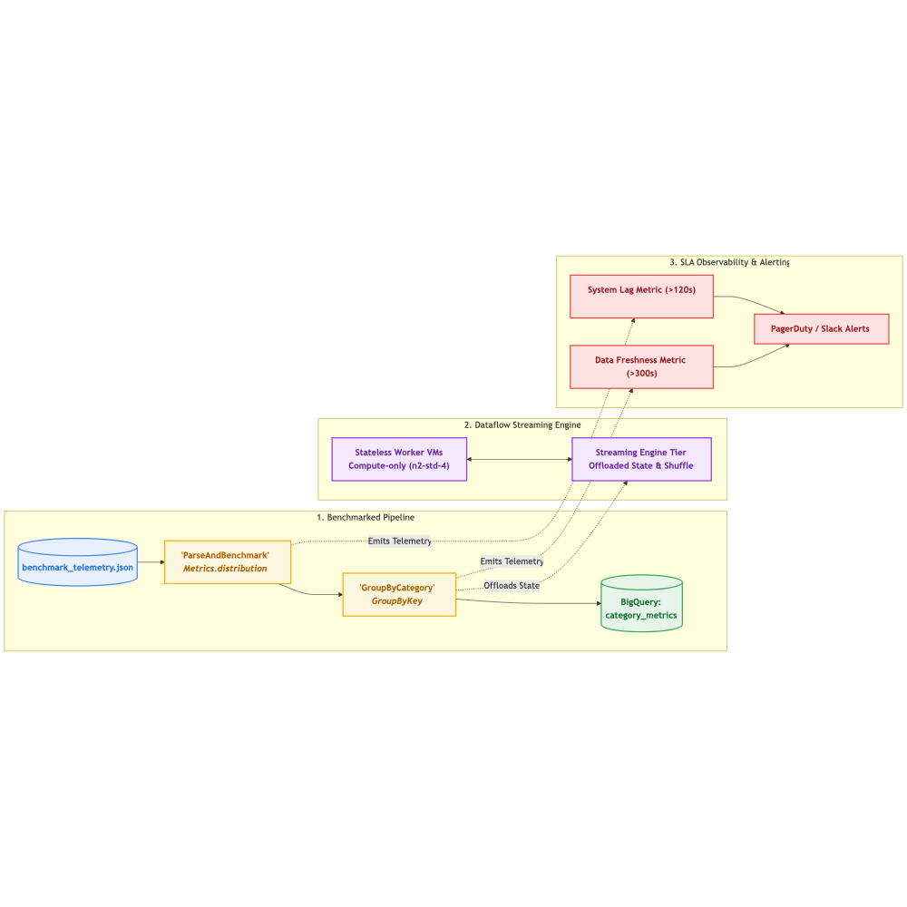
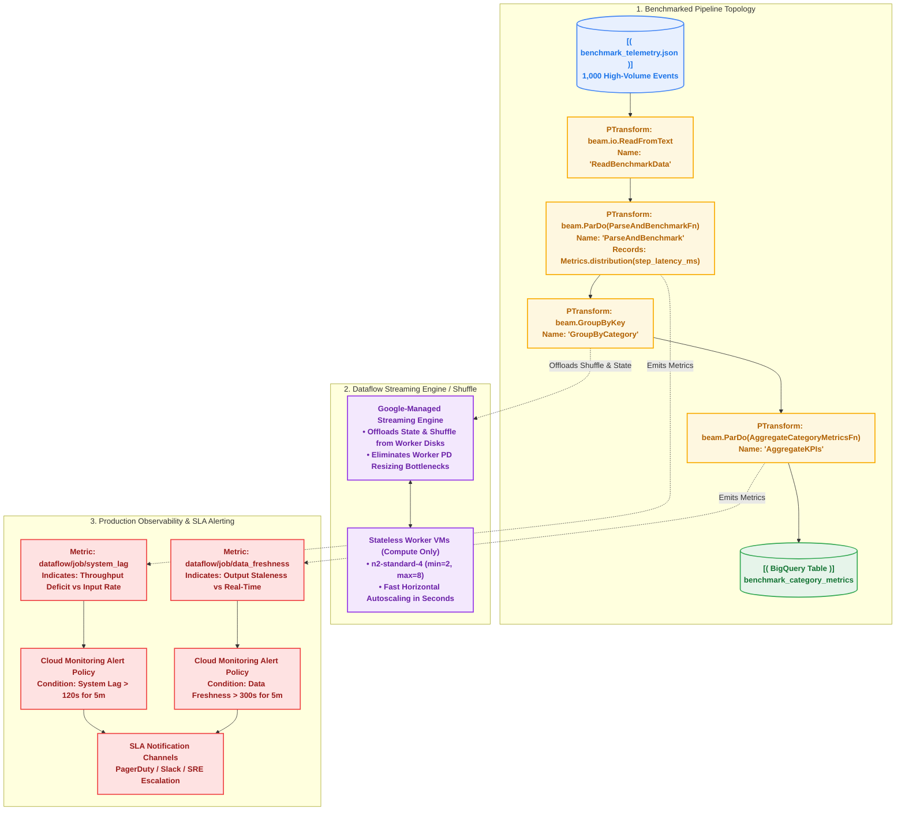

# Chapter 05 — Production Performance, Streaming Engine & Observability

[](https://beam.apache.org/)
[](https://cloud.google.com/dataflow)
[](https://cloud.google.com/monitoring)
[](https://cloud.google.com/bigquery)
[](https://www.python.org/)

Running 24/7 streaming pipelines in production requires deep operational observability and cost-efficient scaling. When downstream dashboards show stale data, data engineers must instantly distinguish between an upstream ingestion pause, a compute throughput deficit, and an un-optimized transform step.

This chapter covers the production architecture of **Dataflow Streaming Engine**, autoscaling optimization, step-level latency profiling with **Apache Beam Metrics**, and automated **Cloud Monitoring SLA Alert Policies**.

---

## Architecture Overview

The pipeline executes a high-volume benchmark workload, tracks step-level execution latency with Beam `Metrics.distribution`, offloads state and shuffle to Google Cloud Streaming Engine, and exports operational signals to Cloud Monitoring:



<details>
<summary><b>View Mermaid Source Code</b></summary>


</details>

---

## 1. Dataflow Streaming Engine & Dataflow Shuffle

In traditional architectures, pipeline state and `GroupByKey` shuffle data are stored on persistent disks (PDs) attached directly to each worker VM:

| Feature | Traditional Worker-Based Execution | Streaming Engine (`--enable_streaming_engine`) |
| :--- | :--- | :--- |
| **State Storage** | Local Persistent Disks on Worker VMs | Dedicated, Google-managed backend service |
| **Autoscaling Speed** | **Slow** (minutes) due to disk detach/attach & state rebalancing | **Near-Instantaneous** (seconds); workers are stateless |
| **Worker Resource Needs** | Requires high-memory, high-disk VM types | Lightweight compute-only VMs (`n2-standard-2` or `4`) |
| **Compute Cost** | Higher VM CPU, RAM, and PD costs | Slashes worker VM costs; charges for Streaming Engine data volume |

> **Production Recommendation**: Always enable `--enable_streaming_engine` for streaming pipelines and `--experiments=shuffle_mode=service` (Dataflow Shuffle) for batch pipelines!

---

## 2. Diagnosing System Lag vs. Data Freshness

Two primary operational signals define pipeline health in Google Cloud Monitoring:

```text
┌────────────────────────────────────────────────────────────────────────┐
│                        DIAGNOSTIC DECISION MATRIX                      │
├──────────────────────────┬──────────────────────────┬──────────────────┤
│ System Lag               │ Data Freshness           │ Root Cause & Fix │
├──────────────────────────┼──────────────────────────┼──────────────────┤
│ 🔺 Consistently Rising   │ 🔺 Degraded (Stale)      │ THROUGHPUT DEFICIT: Processing throughput is lower than input arrival rate. Scale maxNumWorkers or optimize slow transforms. │
│ 🟢 Low / Stable (<5s)    │ 🔺 Degraded (Stale)      │ UPSTREAM PRODUCER IDLE or LARGE WINDOWS: Upstream source has paused sending data, or a large tumbling window (e.g. 1h) has not elapsed yet. │
│ 🔺 Temporarily Spiking   │ 🟢 Acceptable            │ TEMPORARY BURST: Autoscaling will kick in to clear backlog. │
│ 🟢 Low / Stable (<5s)    │ 🟢 Healthy (<30s)        │ NORMAL: Pipeline is keeping pace with real-time stream. │
└──────────────────────────┴──────────────────────────┴──────────────────┘
```

- **System Lag (`dataflow.googleapis.com/job/system_lag`)**: The maximum amount of time an element has been waiting in the pipeline, or current processing delay relative to real time.
- **Data Freshness (`dataflow.googleapis.com/job/data_freshness`)**: The difference between current wall-clock time and the output watermark. Reflects how up-to-date output records are.

---

## 3. Horizontal Autoscaling Tuning

Configure autoscaling parameters to prevent cold-start latency while setting hard budget ceilings:

```bash
--num_workers=2 \           # Initial warm workers upon launch
--min_num_workers=2 \       # Minimum baseline pool to absorb traffic spikes without cold-starts
--max_num_workers=8 \       # Hard upper limit preventing runaway infrastructure costs
--worker_machine_type=n2-standard-4
```

---

## 4. Step-Level Latency Profiling with Beam Metrics

Apache Beam allows embedding fine-grained instrumentation directly inside your `DoFn` lifecycle without external logging services:

```python
from apache_beam.metrics import Metrics

class ParseAndBenchmarkFn(beam.DoFn):
    def __init__(self):
        self.elements_counter = Metrics.counter(self.__class__, "elements_processed")
        self.step_latency_dist = Metrics.distribution(self.__class__, "step_latency_ms")

    def process(self, line: str):
        t0 = time.perf_counter()
        ...
        elapsed_ms = (time.perf_counter() - t0) * 1000.0
        self.elements_counter.inc()
        self.step_latency_dist.update(int(elapsed_ms))
```

---

## 5. Automated SLA Alerting & Cloud Monitoring Dashboard

This chapter provides ready-to-deploy Cloud Monitoring definitions in [`monitoring/`](monitoring/):
1. [`monitoring/alert_policy_system_lag.json`](monitoring/alert_policy_system_lag.json): Triggers PagerDuty/Slack notification if `system_lag > 120s` for 5 minutes.
2. [`monitoring/alert_policy_data_freshness.json`](monitoring/alert_policy_data_freshness.json): Triggers alert if `data_freshness > 300s` for 5 minutes.
3. [`monitoring/dashboard_dataflow_sla.json`](monitoring/dashboard_dataflow_sla.json): Full operational dashboard layout monitoring System Lag, Data Freshness, Worker Count, and Throughput.

---

## Hands-On Execution Guide

### Step 1: Run Local Benchmark (DirectRunner)

Execute the local benchmark script to measure step latency distributions and category aggregations:

```bash
bash 05_streaming_engine_and_monitoring/scripts/01_run_local_benchmark.sh
```

**Output Summary:**
```json
{"category": "electronics", "transaction_count": 201, "total_revenue": 48205.23, "avg_step_latency_ms": 0.644}
{"category": "groceries", "transaction_count": 203, "total_revenue": 49378.39, "avg_step_latency_ms": 0.649}
```

### Step 2: Deploy to Google Cloud Dataflow with Observability

Submit the pipeline with autoscaling and Streaming Engine:

```bash
bash 05_streaming_engine_and_monitoring/scripts/02_run_dataflow_optimized.sh
```

### Step 3: Deploy Cloud Monitoring Alert Policies & Dashboard

Import the provided SLA alert policies and dashboard into your GCP project:

```bash
# 1. Deploy System Lag Alert Policy
gcloud alpha monitoring policies create \
  --policy-from-file=05_streaming_engine_and_monitoring/monitoring/alert_policy_system_lag.json

# 2. Deploy Data Freshness Alert Policy
gcloud alpha monitoring policies create \
  --policy-from-file=05_streaming_engine_and_monitoring/monitoring/alert_policy_data_freshness.json

# 3. Create Cloud Monitoring SLA Dashboard
gcloud monitoring dashboards create \
  --config-from-file=05_streaming_engine_and_monitoring/monitoring/dashboard_dataflow_sla.json
```

---

## Official Documentation & Deep Dives

* [Google Cloud Dataflow Streaming Engine](https://cloud.google.com/dataflow/docs/guides/streaming-engine) — Offloading shuffle and state to Google-managed infrastructure.
* [Google Cloud Dataflow Shuffle Service](https://cloud.google.com/dataflow/docs/guides/dataflow-shuffle) — High-performance batch shuffle for GroupByKey and Combine.
* [Dataflow Monitoring: System Lag & Data Freshness](https://cloud.google.com/dataflow/docs/guides/monitoring-overview#system-lag) — Interpreting streaming backlog and output staleness.
* [Using the Dataflow Monitoring Interface](https://cloud.google.com/dataflow/docs/guides/using-monitoring-intf) — Analyzing step execution times, throughput, and CPU utilization.
* [Google Cloud Monitoring Alerting Policies](https://cloud.google.com/monitoring/alerts) — Setting up SLA alerts and notification channels.

