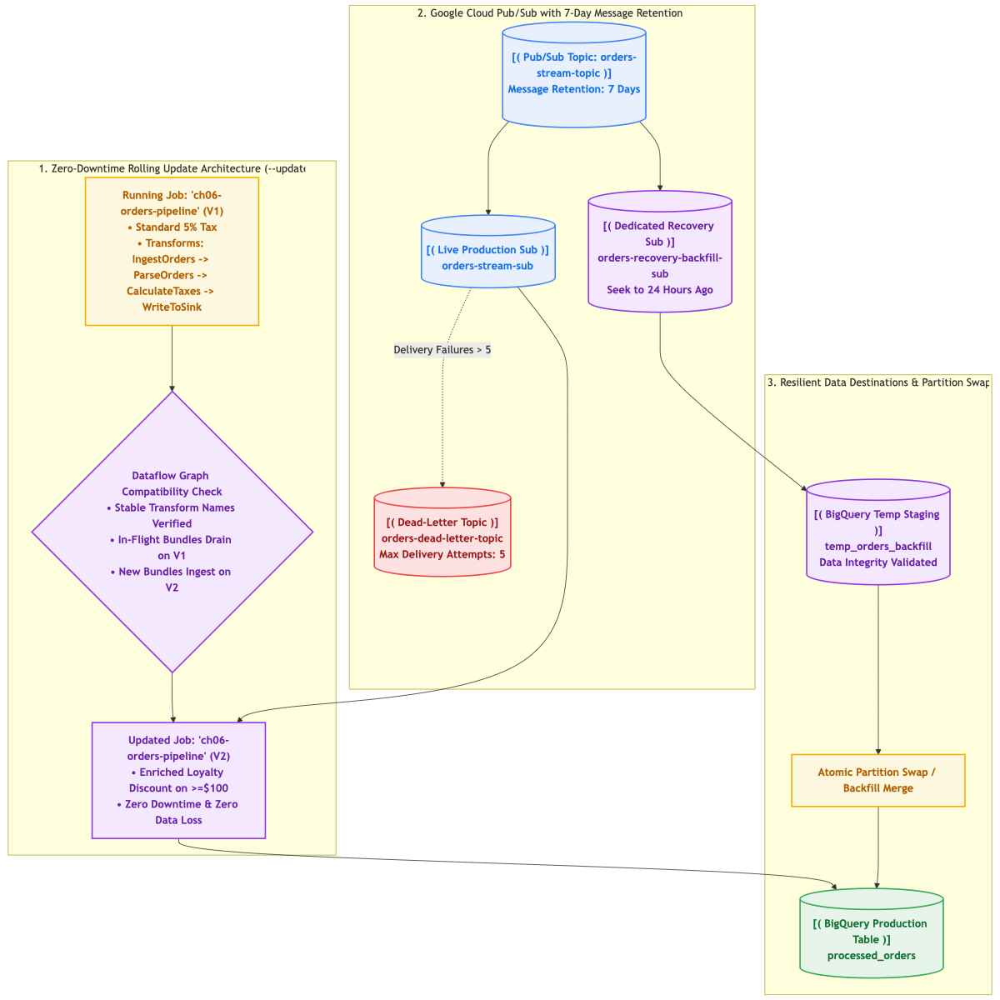
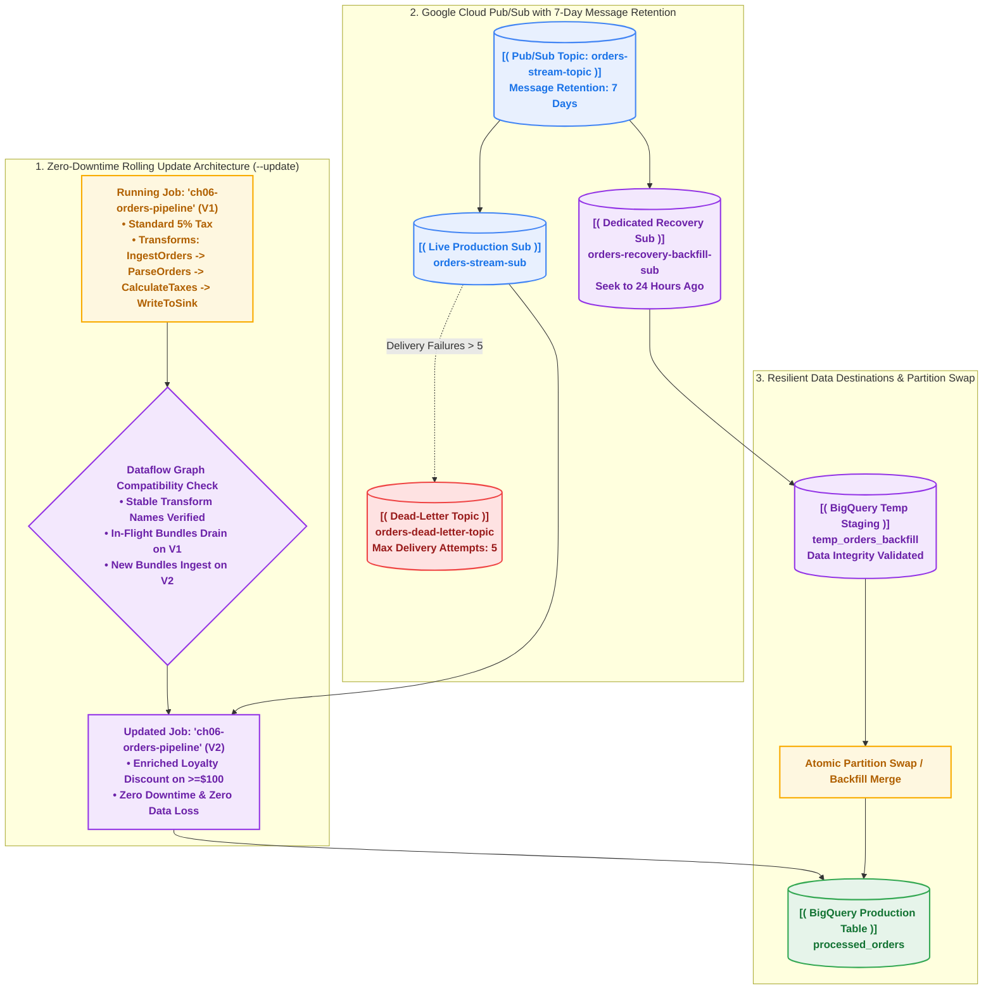

# Chapter 06 — Resilient Operations, Disaster Recovery & Rolling Updates

[](https://beam.apache.org/)
[](https://cloud.google.com/dataflow)
[](https://cloud.google.com/pubsub)
[](https://cloud.google.com/bigquery)
[](https://www.python.org/)

Streaming data pipelines are long-running services intended to operate 24 hours a day, 365 days a year. However, code evolves, business logic changes, bugs are discovered, and downstream corruptions occasionally require historical reprocessing.

Stopping a production pipeline creates processing gaps, while naive restarts can corrupt in-flight state or generate duplicate transactions.

This chapter covers the operational discipline required to run enterprise streaming pipelines on Google Cloud:
1. **In-Place Zero-Downtime Streaming Updates (`--update`)**: Upgrading running Dataflow pipelines while preserving state and processing continuity.
2. **Disaster Recovery via Pub/Sub Subscription Seek**: Safely replaying 24 hours of data to backfill corrupted tables without disrupting live production traffic.
3. **Dead-Letter Topics & Max Delivery Attempts**: Isolating poison records at the messaging layer to prevent infinite worker crash loops.

---

## Architecture Overview

The diagram below contrasts in-place rolling updates with isolated disaster recovery replay:



<details>
<summary><b>View Mermaid Source Code</b></summary>


</details>

---

## 1. Zero-Downtime In-Place Updates (`--update`)

When you need to deploy bug fixes or new features to a running streaming job, traditional web deployment patterns fail:
- **Drain & Snapshot (Anti-Pattern)**: Draining in-flight records takes time and stopping the job creates a processing gap. Restoring from a snapshot requires manual coordination and downtime.
- **Blue-Green Deployments (Anti-Pattern)**: Running two streaming pipelines simultaneously consumes double the infrastructure cost, risks duplicate processing on external sinks, and cannot use load balancers.

### The Solution: Dataflow Update Command
Dataflow supports in-place job replacement using the `--update` flag:

```bash
uv run python pipelines/resilient_stream_v2.py \
  --runner=DataflowRunner \
  --job_name="ch06-orders-pipeline" \
  --update \
  --streaming \
  ...
```

### Graph Compatibility Rules
For Dataflow to accept an update:
1. **Stable Transform Names**: Every transform in the DAG must maintain the same unique name (e.g., `"IngestOrders"`, `"CalculateTaxes"`). If transform names change, specify `--transform_name_mapping` to explicitly map old names to new names.
2. **Coder & State Compatibility**: Output types and per-key state schemas must be backward compatible.
3. **Execution Transition**: Dataflow seamlessly runs both versions concurrently on workers: in-flight bundles finish on the old code while newly ingested elements execute on the new code!

---

## 2. Disaster Recovery via Pub/Sub Subscription Seek

Suppose a critical bug in business logic corrupted downstream BigQuery data 24 hours ago. How do you recover?

### The Production Flaw: Seeking the Live Subscription
Stopping your production pipeline and seeking the live subscription back 24 hours causes severe disruption:
- Ongoing real-time processing halts.
- All downstream systems experience duplicate events.
- Unprocessed real-time backlogs spike system lag.

### The Production Gold Standard: Dedicated Recovery Subscription
1. **Message Retention**: Ensure your Pub/Sub topic has message retention configured (e.g. 7 days):
   ```bash
   gcloud pubsub topics create orders-stream-topic --message-retention-duration=7d
   ```
2. **Create an Isolated Recovery Subscription**:
   ```bash
   gcloud pubsub subscriptions create orders-recovery-backfill-sub \
     --topic=orders-stream-topic
   ```
3. **Seek to Historical Timestamp**:
   ```bash
   gcloud pubsub subscriptions seek orders-recovery-backfill-sub \
     --time="2026-10-26T14:00:00Z"
   ```
4. **Deploy Recovery Pipeline to Staging Sink**: Run a temporary Dataflow job reading from `orders-recovery-backfill-sub` and writing to a temporary BigQuery table (`temp_orders_backfill`).
5. **Atomic Partition Swap**: Once data integrity is verified, merge or swap partitions into the production table using BigQuery DDL.

---

## 3. Pub/Sub Dead-Letter Topics & Poison Pill Defense

When a message payload contains corrupted bytes that crash worker code:
- Without a dead-letter topic, Pub/Sub repeatedly re-delivers the poison pill forever, consuming CPU and generating alerts.
- Configure `--dead-letter-topic` and `--max-delivery-attempts=5`:
  ```bash
  gcloud pubsub subscriptions update orders-stream-sub \
    --dead-letter-topic=orders-dead-letter-topic \
    --max-delivery-attempts=5
  ```
  After 5 failed worker acknowledgments, Pub/Sub routes the poison message to the dead-letter topic and continues normal stream processing.

---

## Hands-On Execution Guide

### Step 1: Simulate Rolling Update Locally (DirectRunner)

Run the comparison script to verify business logic and schema evolution between Version 1 and Version 2:

```bash
bash 06_operations_replay_and_updates/scripts/01_test_rolling_update_simulation.sh
```

**Output Comparison:**
- **Version 1**: Calculates standard 5% tax.
  ```json
  {"order_id": "ord-00001", "subtotal": 291.29, "tax_amount": 14.56, "total_amount": 305.85, "pipeline_version": "v1.0.0"}
  ```
- **Version 2**: Enriches with 10% loyalty discount for orders $\ge \$100$, producing `loyalty_discount` and `net_amount` while keeping transform names identical:
  ```json
  {"order_id": "ord-00001", "subtotal": 291.29, "loyalty_discount": 29.13, "net_amount": 262.16, "tax_amount": 13.11, "total_amount": 275.27, "pipeline_version": "v2.0.0"}
  ```

### Step 2: Deploy and Perform In-Place Update on Cloud Dataflow

Inspect and run the rolling update automation:

```bash
bash 06_operations_replay_and_updates/scripts/02_deploy_v1_and_update_v2.sh
```

### Step 3: Execute Disaster Recovery Seek Replay

Simulate historical data recovery without impacting live production:

```bash
bash 06_operations_replay_and_updates/scripts/03_disaster_recovery_seek_replay.sh
```

---

## Official Documentation & Deep Dives

* [Updating an Existing Dataflow Pipeline](https://cloud.google.com/dataflow/docs/guides/updating-a-pipeline) — Deep dive into in-place `--update`, transform name compatibility, and drained bundle transitions.
* [Stopping a Running Dataflow Job (Drain vs. Cancel)](https://cloud.google.com/dataflow/docs/guides/stopping-a-pipeline) — Understanding zero-loss graceful drain and state flush mechanics.
* [Pub/Sub Replay and Seek Overview](https://cloud.google.com/pubsub/docs/replay-overview) — Replaying unacknowledged and acknowledged messages to timestamp or snapshot.
* [Handling Message Failures with Pub/Sub Dead-Letter Topics](https://cloud.google.com/pubsub/docs/handling-failures#dead_letter_topic) — Forwarding poison pills and setting `max_delivery_attempts`.
* [Cloud Pub/Sub Message Retention](https://cloud.google.com/pubsub/docs/subscriber#message_retention) — Configuring topic and subscription retention duration for auditability and recovery.

