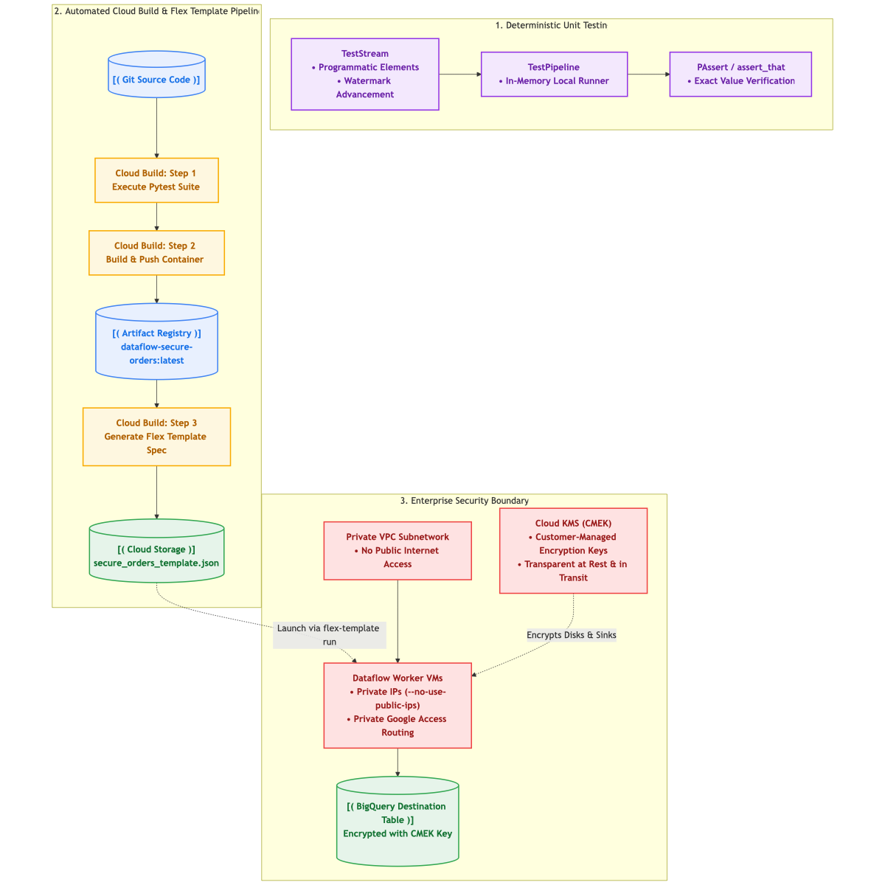
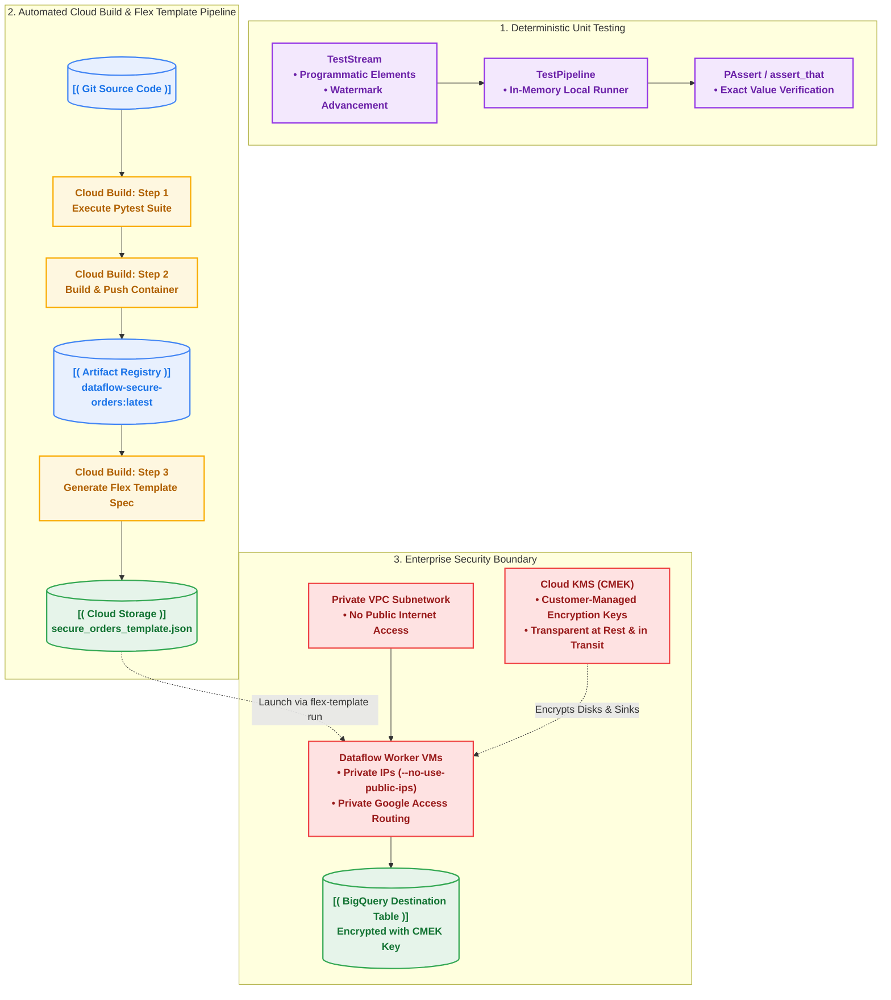

# Chapter 07 — Unit Testing, Docker Flex Templates, CI/CD & Security

[](https://beam.apache.org/)
[](https://cloud.google.com/dataflow)
[](https://cloud.google.com/build)
[](https://cloud.google.com/artifact-registry)
[](https://cloud.google.com/security-key-management)
[](https://www.python.org/)

Building production data pipelines is only half the battle. Delivering mission-critical systems into regulated enterprise environments requires automated quality engineering, containerized packaging, continuous delivery, and strict security compliance.

This final chapter brings together the entire software development lifecycle (SDLC) for Apache Beam and Google Cloud Dataflow:
1. **Deterministic Quality Assurance**: Writing fast, isolated unit tests using `TestPipeline`, `PAssert`, and `TestStream` to test streaming watermarks without GCP resources.
2. **Containerized Dataflow Flex Templates**: Packaging pipelines into Docker container images stored in **Google Cloud Artifact Registry**.
3. **Automated CI/CD**: Orchestrating testing, container building, and template generation via **Google Cloud Build**.
4. **Enterprise Security Hardening**: Enforcing **Private IPs** (`--no-use-public-ips`), **Private Google Access**, and **Customer-Managed Encryption Keys (CMEK)**.

---

## Architecture Overview

The end-to-end testing, packaging, delivery, and security architecture is shown below:



<details>
<summary><b>View Mermaid Source Code</b></summary>


</details>

---

## 1. Unit Testing with `TestPipeline`, `PAssert` & `TestStream`

In Apache Beam, standard `assert` statements fail because operations are distributed across workers. Beam provides specialized testing primitives:

### `TestPipeline` & `PAssert`
- `TestPipeline`: A local in-memory runner that automatically applies test assertions before pipeline completion.
- `assert_that(pcollection, equal_to(expected_list))`: Validates collection content deterministically regardless of processing order.

```python
with TestPipeline() as p:
    orders = p | beam.Create([("ord-01", 100.0)])
    results = orders | beam.ParDo(CalculateTaxFn())
    assert_that(results, equal_to([{"order_id": "ord-01", "total": 105.0}]))
```

### `TestStream`: Testing Unbounded Streams & Watermarks
`TestStream` simulates streaming conditions in unit tests without external Pub/Sub brokers:
- Injecting timestamped elements: `.add_elements([TimestampedValue(data, ts)])`
- Advancing event-time watermarks: `.advance_watermark_to(60)`
- Advancing wall-clock processing time: `.advance_processing_time(10)`

---

## 2. Containerized Dataflow Flex Templates

Unlike Classic Dataflow Templates (which compile static graphs at build time), **Flex Templates** package your pipeline into a Docker container image:
- **Dynamic Graph Construction**: Pipeline parameters are evaluated at runtime when the job is submitted.
- **Custom Dependencies**: System-level libraries (C++, OpenCV, custom ODBC drivers) can be installed inside the Dockerfile.
- **Image Registry**: Images are stored in Google Cloud Artifact Registry (`europe-west1-docker.pkg.dev/...`).

### Flex Template Packaging
1. **`template/Dockerfile`**: Based on `gcr.io/dataflow-templates-base/python311-template-launcher-base`.
2. **`template/metadata.json`**: Declares required and optional CLI parameters with validation regexes.
3. **Template Specification**: Compiled into a lightweight JSON file stored in Google Cloud Storage:
   ```bash
   gcloud dataflow flex-template build gs://BUCKET/templates/my_template.json \
     --image=REGION-docker.pkg.dev/PROJECT/REPO/IMAGE:latest \
     --sdk-language=PYTHON \
     --metadata-file=template/metadata.json
   ```

---

## 3. Automated CI/CD with Google Cloud Build

The provided [`cicd/cloudbuild.yaml`](cicd/cloudbuild.yaml) orchestrates automated delivery:
1. **Test Phase**: Installs dependencies and runs unit tests via `pytest`. If tests fail, the build halts immediately.
2. **Build Phase**: Compiles the Docker image and tags it with `${SHORT_SHA}` and `latest`.
3. **Publish Phase**: Pushes the image to Artifact Registry.
4. **Register Phase**: Compiles the Flex Template JSON spec in Cloud Storage ready for deployment.

---

## 4. Enterprise Security Hardening

In enterprise and regulated financial or healthcare environments, security compliance requires three controls:

### 1. Private IPs (`--no-use-public-ips`)
- Prevents Dataflow worker VMs from receiving public IPv4 addresses.
- Workers cannot directly access the public internet, eliminating ingress/egress attack surfaces.
- Enabled via: `--no_use_public_ips` (Beam option) or `--disable-public-ips` (`gcloud` CLI).

### 2. Private Google Access & Custom Subnets
- Worker VMs communicate with Google Cloud APIs (Cloud Storage, BigQuery, Pub/Sub, Cloud Logging) over internal Google networks via **Private Google Access** enabled on the VPC subnet:
  ```bash
  --subnetwork="https://www.googleapis.com/compute/v1/projects/PROJECT/regions/REGION/subnetworks/SUBNET"
  ```

### 3. Customer-Managed Encryption Keys (CMEK)
- Encrypts Dataflow worker persistent disk shuffle buffers, Cloud Storage staging files, and BigQuery tables using customer-controlled keys managed in **Cloud KMS**:
  ```bash
  --dataflow_kms_key="projects/PROJECT/locations/LOCATION/keyRings/RING/cryptoKeys/KEY"
  ```

---

## Hands-On Execution Guide

### Step 1: Run Unit Tests Locally

Execute the local unit test suite using `pytest`:

```bash
bash 07_testing_templates_and_cicd/scripts/01_run_unit_tests.sh
```

**Expected Test Output:**
```text
tests/test_streaming_teststream.py::TestStreamingPipelines::test_windowing_with_test_stream PASSED
tests/test_transforms.py::TestOrderTransforms::test_tax_calculation_negative_subtotal_dlq PASSED
tests/test_transforms.py::TestOrderTransforms::test_tax_calculation_success PASSED
======================== 3 passed in 2.96s =========================
```

### Step 2: Build & Register the Flex Template

Build the container image and register the Flex Template spec in Google Cloud:

```bash
bash 07_testing_templates_and_cicd/scripts/02_build_flex_template.sh
```

### Step 3: Run the Flex Template with Enterprise Security

Launch the containerized template with Private IPs, custom VPC subnetwork, and CMEK encryption:

```bash
bash 07_testing_templates_and_cicd/scripts/03_run_secure_flex_template.sh
```
