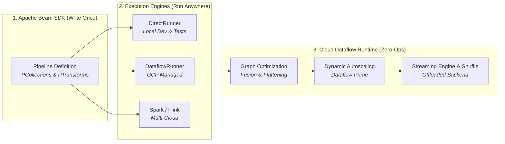
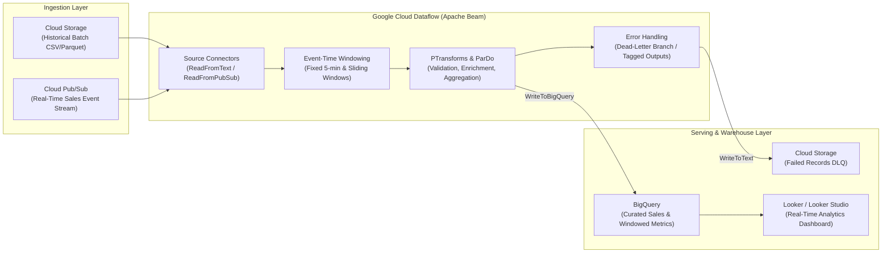
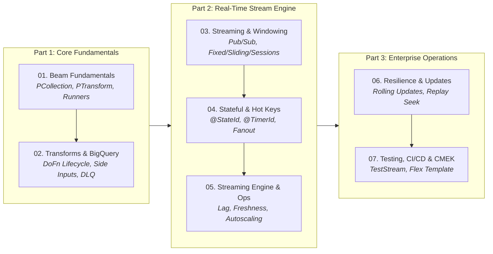

# Google Cloud Dataflow & Apache Beam Workshop

> **Google Cloud Modern Data Engineering Series**
> * **Stream & Serverless Processing Layer (This Repo):** [`dataflow-workshops`](https://github.com/EilinLux/dataflow-workshops) *(Unified Batch & Streaming Pipelines with Apache Beam, Streaming Engine & Flex Templates)*
> * **Compute Layer:** [`dataproc-workshop`](https://github.com/EilinLux/dataproc-workshop) *(Developing PySpark ETL jobs & `utils.py` on Dataproc Clusters and Dataproc Serverless)*
> * **Orchestration Layer:** [`composer-workshop`](https://github.com/EilinLux/composer-workshop) *(Scheduling, Deferrable Sensors, BigQuery Quality Gates & Local `DagBag` Testing with Cloud Composer 3)*
> * **Production CI/CD Blueprint:** [`CiCdAirFlowDagTemplate`](https://github.com/EilinLux/CiCdAirFlowDagTemplate) *(Automated Cloud Build CI/CD pipelines for testing & syncing DAGs to Cloud Composer)*

---

## What is Google Cloud Dataflow?

Modern data engineering demands processing both historical bounded data (daily batch files, warehouse extracts) and continuous unbounded data (clickstreams, IoT telemetry, real-time financial transactions). Historically, teams had to maintain two completely separate architectures: one engine for batch (like Hadoop/Spark) and another for streaming (like Storm/Flink)—an anti-pattern known as the **Lambda Architecture**, which resulted in duplicate pipeline logic, disparate APIs, and synchronization nightmares.

**Google Cloud Dataflow** solves this challenge. It is Google Cloud's fully managed, serverless, horizontally auto-scaling execution service for running unified stream and batch pipelines written in **Apache Beam**.



With Dataflow, you define your pipeline logic using the open-source **Apache Beam SDK** and deploy it to Google Cloud. Dataflow automatically provisions compute resources, balances workloads dynamically across worker VMs, integrates natively with Google Cloud managed storage services, and tears down infrastructure when batch jobs finish—or scales horizontally to absorb unpredictable streaming traffic spikes with millisecond latency.

---

## Core Pillars of Google Cloud Dataflow

### 1. Unified Batch and Streaming with Apache Beam
Apache Beam (combining **B**atch + Str**eam**) provides a single API where bounded and unbounded datasets are represented by the exact same primitive: a **`PCollection`**. 
- In **Batch Mode**, the `PCollection` represents a fixed, bounded dataset (e.g., historical Parquet/CSV files on Cloud Storage or a BigQuery table partition).
- In **Streaming Mode**, the `PCollection` represents an infinite, unbounded stream of events arriving from message brokers like **Cloud Pub/Sub** or **Apache Kafka**.

⚠️ **Switching a pipeline from batch to streaming** often requires changing only the source connector and defining an event-time windowing strategy.

### 2. True Serverless & Zero-Ops Management
Traditional distributed compute (such as standalone Spark or Flink clusters) requires teams to size master/worker nodes, configure memory limits, patch operating systems, and tune cluster yarn parameters. Dataflow abstracts all infrastructure:
- **No Cluster Sizing**: You never configure cluster topologies or master nodes.
- **Fast Startup & Instant Scale-Down**: Batch workers spin up on demand and shut down immediately upon pipeline completion, ensuring you only pay for the exact compute seconds consumed.
- **Managed Autoscaling**: Dataflow continuously monitors throughput, backlog size, and CPU utilization, automatically adding or removing worker VMs in real time.

### 3. Dynamic Work Rebalancing (Liquid Shuffling)
In traditional MapReduce and Spark jobs, straggling tasks (caused by uneven data splits, slow worker nodes, or key skew) can hold up an entire stage for hours. Dataflow continuously inspects the processing rate of every worker. If one worker is lagging behind, Dataflow dynamically splits the remaining unprocessed portion of that worker's work item and redistributes it to an idle worker—without failing or restarting the task.

### 4. Decoupled Compute and State: Streaming Engine & Dataflow Shuffle
Dataflow separates compute workers from shuffle and state management:
* **Dataflow Shuffle (for Batch)**: Moves the execution of shuffle operations (such as `GroupByKey` and `CoGroupByKey`) off worker disks and memory into a dedicated Google-managed shuffle service, accelerating batch jobs and reducing worker memory pressure.
* **Streaming Engine (for Streaming)**: Offloads window state storage and streaming shuffle processing from worker VMs to a purpose-built backend service. This drastically reduces worker VM memory footprint, accelerates autoscaling responsiveness, and provides smoother latency profiles.

### 5. Robust Exactly-Once Semantics & Event-Time Processing
Dataflow natively handles out-of-order data, late-arriving records, and network retries:
* **Event Time vs. Processing Time**: Pipelines reason about data based on when the event actually occurred in the physical world (`Event Time`), rather than when the data arrived at the cloud ingestion service (`Processing Time`).
* **Watermarks**: Monotonically advancing timestamps that track the system's progress and estimate when all data up to a given event timestamp has been observed.
* **Windowing & Triggers**: Flexible temporal grouping—**Fixed (Tumbling)**, **Sliding (Hopping)**, and dynamic user activity **Session Windows**—paired with custom triggers and allowed lateness for deterministic downstream BigQuery / Cloud Storage writes.

### 6. Dataflow Templates & Flex Templates
Dataflow simplifies enterprise operations through containerized **Flex Templates**:
* Developers package Beam pipelines inside standard Docker containers and store the template specification in Cloud Storage.
* Non-developers, automated CI/CD pipelines, or orchestration engines (such as **Cloud Composer / Apache Airflow**) can trigger jobs with custom runtime parameters via the `gcloud` CLI, REST API, or Cloud Console without needing a local Python/Java development environment.

---

## Dataflow vs. Dataproc: When to Use What?

Both **Dataflow** and **Dataproc** are premier data processing services on Google Cloud, but they serve different engineering paradigms:

| Feature / Criteria | Google Cloud Dataflow | Google Cloud Dataproc |
| :--- | :--- | :--- |
| **Primary Programming Model** | **Apache Beam** (Python, Java, Go, YAML) | **Apache Spark**, PySpark, Hadoop, Flink, Presto |
| **Infrastructure Model** | **Fully Serverless**: Zero cluster management, no master nodes | **Cluster-Centric** (Compute Engine VMs) or **Dataproc Serverless** |
| **Batch vs. Streaming** | **Unified Engine**: Native, world-class streaming with millisecond latency | Primarily batch/micro-batch (**Spark Structured Streaming**) |
| **Autoscaling Mechanism** | Dynamic work rebalancing + Liquid Shuffling | YARN / Spark dynamic allocation + VM autoscaling policies |
| **Windowing & Watermarks** | Comprehensive, native out-of-order event-time processing | Supported via Spark Structured Streaming watermarks |
| **Ecosystem Portability** | Write once in Beam; run on Dataflow, Spark, Flink, or DirectRunner | Write once in Spark; run on Dataproc, EMR, on-prem, or Databricks |
| **Best Used For** | Real-time event streams (Pub/Sub $\rightarrow$ BigQuery), event-time analytics, serverless ETL | Legacy Spark/Hadoop migrations, Spark MLlib, ad-hoc interactive Jupyter analysis |

---

## End-to-End Workshop Pipeline Architecture

In this workshop, you will build and deploy a production-grade, enterprise retail streaming and batch data processing platform on Google Cloud:



---

## The Workshop Storyline: From Local Beam to Enterprise Streaming

This workshop is structured as a hands-on, progressive curriculum taking you from zero to production Dataflow expertise:



### Chapter 01 — Apache Beam & Dataflow Fundamentals (`01_beam_fundamentals/`)
* Understanding the Beam execution abstraction: Drivers, Workers, PCollections, and PTransforms.
* Local development and unit testing with `DirectRunner`.
* Submitting your first batch pipeline to **Google Cloud Dataflow** (`DataflowRunner`).
* Inspecting job execution graphs and step metrics in the Google Cloud Console.

### Chapter 02 — Deep Dive into PTransforms & BigQuery I/O (`02_transforms_and_bigquery/`)
* Mastering `beam.ParDo` and custom `DoFn` lifecycle methods (`setup`, `process`, `teardown`).
* Sharing reference data using **Side Inputs** (`beam.pvalue.AsDict`, `beam.pvalue.AsList`).
* Branching data streams with **Tagged Multi-Outputs** (`beam.Tag`, dead-letter queues).
* Efficient high-throughput reads and writes using the **BigQuery Storage Write API**.

### Chapter 03 — Real-Time Streaming, Windowing & Late Data (`03_realtime_streaming/`)
* Ingesting unbounded telemetry from **Google Cloud Pub/Sub** with **Ordering Keys**.
* Implementing temporal aggregation: **Fixed (Tumbling)**, **Sliding (Hopping)** for moving averages, and **Session Windows** (activity gaps).
* Mastering event-time vs. processing-time, watermarks, allowed lateness, and accumulation triggers (preliminary results + late updates).
* Isolating unparseable poison messages into dead-letter sinks.

### Chapter 04 — Stateful Processing, Timers & Hot Key Fanout (`04_stateful_processing_and_hotkeys/`)
* Stateful stream processing using `@StateId` (ValueState / BagState) for per-key rolling statistics without external databases.
* Automated state expiration and scheduled window calculations using `@TimerId`.
* Mitigating data skew and hot key errors using `CombinePerKey` with **`withHotKeyFanout`**.

### Chapter 05 — Production Performance, Streaming Engine & Observability (`05_streaming_engine_and_monitoring/`)
* Leveraging **Dataflow Streaming Engine** and **Dataflow Shuffle** to offload state and slash worker VM costs.
* Diagnosing **System Lag**, **Data Freshness**, and step-level execution time.
* Tuning horizontal autoscaling: `maxNumWorkers`, `minNumWorkers`, and worker machine types.
* Configuring Cloud Monitoring SLA alerts with notification channels (Slack / PagerDuty).

### Chapter 06 — Resilient Operations, Disaster Recovery & Rolling Updates (`06_operations_replay_and_updates/`)
* In-place **Zero-Downtime Streaming Updates** (`gcloud dataflow jobs run --update`) maintaining state compatibility.
* Disaster recovery using **Pub/Sub Message Retention** and **Subscription Seek** to safely replay 24 hours of data.
* Configuring Pub/Sub Dead-Letter Topics with maximum delivery attempt policies.

### Chapter 07 — Unit Testing, Docker Flex Templates, CI/CD & Security (`07_testing_templates_and_cicd/`)
* Deterministic unit testing using `TestPipeline`, `PAssert`, and `TestStream`.
* Packaging production pipelines into containerized **Dataflow Flex Templates** stored in **Artifact Registry**.
* Automated Cloud Build CI/CD verification pipelines.
* Enterprise security: Private IPs (`--no-use-public-ips`), Private Google Access, VPC Service Controls, and Customer-Managed Encryption Keys (**CMEK**).

---

## Repository Structure

```text
dataflow-workshops/
├── .env.example                                      # Template with GCP, Dataflow & BigQuery variables
├── .env                                              # Local environment variables (git-ignored)
├── pyproject.toml                                    # Python dependencies managed with uv
├── uv.lock                                           # Locked dependency resolution
├── README.md                                         # Main workshop index & comprehensive Dataflow guide
│
├── 01_beam_fundamentals/                             # Chapter 01: Apache Beam & Dataflow Fundamentals
│   ├── README.md                                     # Chapter documentation & execution guide
│   ├── 01_beam_fundamentals.ipynb                    # Interactive notebook covering Beam model & local/cloud runs
│   ├── data/
│   │   └── sales_data.csv                            # Sample retail transactions dataset
│   ├── pipelines/
│   │   └── sales_pipeline.py                         # Production-grade Beam pipeline script (Direct & Dataflow)
│   └── scripts/
│       ├── 01_run_local.sh                           # Local execution script (DirectRunner)
│       └── 02_run_dataflow.sh                        # Cloud Dataflow submission script (DataflowRunner)
│
├── 02_transforms_and_bigquery/                       # Chapter 02: Advanced Transforms, Side Inputs & BigQuery I/O
│   ├── README.md                                     # Chapter documentation, architecture & quick start
│   ├── 02_transforms_and_bigquery.ipynb              # Interactive notebook with DoFn lifecycle, Side Inputs & DLQ
│   ├── data/
│   │   ├── sales_data_with_errors.csv                # Sales data with valid and intentional poison rows
│   │   └── product_catalog.json                      # Reference product catalog for Side Input lookup
│   ├── pipelines/
│   │   └── enrich_and_load_bq.py                     # Production pipeline (Storage Write API & DLQ)
│   └── scripts/
│       ├── 01_run_local.sh                           # Local execution script (DirectRunner)
│       └── 02_run_dataflow.sh                        # Cloud Dataflow submission script (DataflowRunner)
│
├── 03_realtime_streaming/                            # Chapter 03: Real-Time Pub/Sub Streaming, Windowing & Late Data
│   ├── README.md                                     # Chapter documentation & windowing guide
│   ├── 03_realtime_streaming.ipynb                   # Interactive notebook with Tumbling, Sliding & Session Windows
│   ├── data/
│   │   └── sample_events.json                        # Synthetic telemetry stream (valid, late, poison records)
│   ├── pipelines/
│   │   └── streaming_windowing_pipeline.py           # Production streaming pipeline with Pub/Sub & BigQuery
│   └── scripts/
│       ├── 01_run_local.sh                           # Local streaming simulation script (DirectRunner)
│       ├── 02_run_dataflow.sh                        # DataflowRunner streaming submission script
│       └── generate_streaming_data.py                # Pub/Sub streaming publisher with timestamps & drift
│
├── 04_stateful_processing_and_hotkeys/               # Chapter 04: Stateful Processing, Timers & Hot Key Fanout
│   ├── README.md                                     # Chapter documentation & hot key guide
│   ├── 04_stateful_processing_and_hotkeys.ipynb      # Interactive notebook with stateful DoFns & fanout
│   ├── data/
│   │   └── skewed_clickstream.json                   # Skewed telemetry stream (500 celebrity events vs 5 normal)
│   ├── pipelines/
│   │   └── stateful_and_fanout_pipeline.py           # Production pipeline with @StateId, @TimerId & withHotKeyFanout
│   └── scripts/
│       ├── 01_run_local.sh                           # Local execution script (DirectRunner)
│       └── 02_run_dataflow.sh                        # Cloud Dataflow submission script
│
├── 05_streaming_engine_and_monitoring/               # Chapter 05: Production Performance, Streaming Engine & Observability
│   ├── README.md                                     # Chapter documentation & monitoring guide
│   ├── 05_streaming_engine_and_monitoring.ipynb      # Interactive notebook with metrics & latency profiling
│   ├── data/
│   │   └── benchmark_telemetry.json                  # High-volume synthetic benchmark stream
│   ├── pipelines/
│   │   └── benchmarked_streaming_pipeline.py         # Pipeline with Beam Metrics.distribution & Streaming Engine
│   ├── monitoring/
│   │   ├── alert_policy_system_lag.json              # Cloud Monitoring SLA Alert Policy (System Lag > 120s)
│   │   ├── alert_policy_data_freshness.json          # Cloud Monitoring Alert Policy (Data Freshness > 300s)
│   │   └── dashboard_dataflow_sla.json               # Cloud Monitoring Dashboard configuration
│   └── scripts/
│       ├── 01_run_local_benchmark.sh                 # Local benchmark runner (DirectRunner)
│       └── 02_run_dataflow_optimized.sh              # Cloud submission script with autoscaling
│
├── 06_operations_replay_and_updates/                 # Chapter 06: Resilient Operations, Disaster Recovery & Rolling Updates
│   ├── README.md                                     # Chapter documentation & recovery guide
│   ├── 06_operations_replay_and_updates.ipynb        # Interactive notebook with rolling updates & seek
│   ├── data/
│   │   └── replay_telemetry.json                     # 24-hour historical telemetry stream
│   ├── pipelines/
│   │   ├── resilient_stream_v1.py                    # Pipeline Version 1 (Baseline logic)
│   │   └── resilient_stream_v2.py                    # Pipeline Version 2 (In-place rolling update)
│   └── scripts/
│       ├── 01_test_rolling_update_simulation.sh      # Local simulation comparing V1 vs V2
│       ├── 02_deploy_v1_and_update_v2.sh             # Zero-downtime rolling update submission
│       └── 03_disaster_recovery_seek_replay.sh       # Disaster recovery via Pub/Sub subscription seek
│
├── 07_testing_templates_and_cicd/                    # Chapter 07: Unit Testing, Docker Flex Templates, CI/CD & Security
│   ├── README.md                                     # Chapter documentation & security guide
│   ├── 07_testing_templates_and_cicd.ipynb           # Interactive notebook with TestStream, Flex Templates & CMEK
│   ├── tests/
│   │   ├── test_transforms.py                        # Deterministic unit tests (TestPipeline & assert_that)
│   │   └── test_streaming_teststream.py              # Streaming unit tests (TestStream watermark testing)
│   ├── template/
│   │   ├── Dockerfile                                # Flex Template container definition
│   │   ├── metadata.json                             # Template parameters specification
│   │   └── requirements.txt                          # Container dependencies
│   ├── cicd/
│   │   └── cloudbuild.yaml                           # Automated Cloud Build CI/CD pipeline
│   ├── pipelines/
│   │   └── secure_orders_pipeline.py                 # Pipeline with CMEK, Private IPs, and VPC controls
│   └── scripts/
│       ├── 01_run_unit_tests.sh                      # Local unit test runner (pytest)
│       ├── 02_build_flex_template.sh                 # Docker build & Artifact Registry push
│       └── 03_run_secure_flex_template.sh            # Secure execution with Private IPs & CMEK
│
└── artifacts/                                        # Pre-rendered high-res SVG & PNG pipeline architecture diagrams
    ├── 01_numbers_pipeline_dag.png
    ├── 01_sales_pipeline_dag.png
    ├── 02_side_inputs_and_bq_dag.png
    ├── 03_windowing_and_streaming_dag.png
    ├── 04_stateful_and_fanout_dag.png
    ├── 05_streaming_engine_and_monitoring_dag.png
    ├── 06_resilient_ops_and_updates_dag.png
    └── 07_testing_templates_and_cicd_dag.png
```

---

## Apache Beam & Dataflow Core Concepts Quick Reference

A complete reference of all fundamental abstractions, streaming primitives, stateful operators, observability metrics, and enterprise security patterns demonstrated throughout this repository:

| Concept | Chapter / Folder | Category | Description | Production Code Example |
| :--- | :--- | :--- | :--- | :--- |
| **`Pipeline` & `PipelineOptions`** | [`01_beam_fundamentals/`](01_beam_fundamentals/) | Core Abstraction | Root directed acyclic graph (DAG) container configured with runner, worker, and GCP project options. | `with beam.Pipeline(options=PipelineOptions()) as p:` |
| **`PCollection`** | [`01_beam_fundamentals/`](01_beam_fundamentals/) | Core Abstraction | Immutable distributed dataset representing bounded batch or unbounded streaming data. | `lines = p \| "Read" >> beam.io.ReadFromText("gs://...")` |
| **`PTransform`** | [`01_beam_fundamentals/`](01_beam_fundamentals/) | Core Abstraction | Data transformation step piped with `\|` and assigned a unique step name using `>>`. | `output = input \| "StepLabel" >> CustomTransform()` |
| **`DirectRunner` vs `DataflowRunner`** | [`01_beam_fundamentals/`](01_beam_fundamentals/) | Execution Engines | Local in-memory runner for debugging/tests vs. Google Cloud zero-ops distributed serverless service. | `--runner=DataflowRunner --project=$PROJECT_ID` |
| **`Map` & `FlatMap`** | [`01_beam_fundamentals/`](01_beam_fundamentals/) | Element-wise | Functional transforms for 1-to-1 element mapping or 1-to-many list flattening without state. | `words = lines \| "Split" >> beam.FlatMap(lambda x: x.split())` |
| **`Filter`** | [`01_beam_fundamentals/`](01_beam_fundamentals/) | Element-wise | Predicate-based element filtering evaluating each record to True or False. | `valid = records \| "Filter" >> beam.Filter(lambda x: x["amt"] > 0)` |
| **`DoFn` Lifecycle** | [`02_transforms_and_bigquery/`](02_transforms_and_bigquery/) | Custom Processing | Distributed worker class lifecycle hooks: `setup()`, `process()`, `finish_bundle()`, `teardown()`. | `class ProcessFn(beam.DoFn): def setup(self): ...` |
| **Side Inputs (`AsDict`, `AsList`)** | [`02_transforms_and_bigquery/`](02_transforms_and_bigquery/) | Cross-Data Lookup | Broadcasting auxiliary lookup collections to all worker DoFns without cross-cluster join shuffles. | `pcoll \| beam.ParDo(EnrichFn(), cat=beam.pvalue.AsDict(cat_pcoll))` |
| **Tagged Outputs (`TaggedOutput` / DLQ)** | [`02_transforms_and_bigquery/`](02_transforms_and_bigquery/) | Multi-Branching | Routing malformed or failed records to an isolated dead-letter queue while good data continues. | `yield beam.pvalue.TaggedOutput("dead_letter", error_record)` |
| **BigQuery Storage Write API** | [`02_transforms_and_bigquery/`](02_transforms_and_bigquery/) | Managed I/O Sink | High-throughput, low-latency append stream writing directly into BigQuery with exactly-once guarantees. | `beam.io.WriteToBigQuery(table, method="STORAGE_WRITE_API")` |
| **Pub/Sub Stream Ingestion** | [`03_realtime_streaming/`](03_realtime_streaming/) | Stream Ingestion | Ingesting unbounded streaming messages with message ordering keys and publish timestamps. | `p \| beam.io.ReadFromPubSub(subscription=sub_path)` |
| **Event Timestamps & Watermarks** | [`03_realtime_streaming/`](03_realtime_streaming/) | Time Semantics | Attaching event-time timestamps (`TimestampedValue`) and advancing watermark clocks across steps. | `beam.window.TimestampedValue(record, epoch_timestamp)` |
| **Fixed (Tumbling) Windows** | [`03_realtime_streaming/`](03_realtime_streaming/) | Windowing | Segmenting stream elements into continuous, non-overlapping uniform intervals (e.g., 60-second buckets). | `pcoll \| beam.WindowInto(FixedWindows(60))` |
| **Sliding (Hopping) Windows** | [`03_realtime_streaming/`](03_realtime_streaming/) | Windowing | Overlapping uniform intervals for continuous rolling aggregates and moving rate averages. | `pcoll \| beam.WindowInto(SlidingWindows(size=300, period=60))` |
| **Session Windows** | [`03_realtime_streaming/`](03_realtime_streaming/) | Windowing | Dynamic per-key activity windows demarcated by periods of inactivity exceeding a gap threshold. | `pcoll \| beam.WindowInto(Sessions(gap_size=300))` |
| **Allowed Lateness & Accumulation** | [`03_realtime_streaming/`](03_realtime_streaming/) | Time Semantics | Retaining window state beyond watermark to process late arrivals and update existing aggregations. | `allowed_lateness=86400, accumulation_mode=AccumulationMode.ACCUMULATING` |
| **Watermark Triggers** | [`03_realtime_streaming/`](03_realtime_streaming/) | Window Triggers | Specifying early speculative firings, on-time watermark firings, and late-arriving delta firings. | `trigger=AfterWatermark(early=AfterCount(10), late=AfterCount(1))` |
| **Stateful `DoFn` (`@StateId`)** | [`04_stateful_processing_and_hotkeys/`](04_stateful_processing_and_hotkeys/) | Stateful Processing | Managing per-key persistent state (`ReadModifyWriteStateSpec`, `BagStateSpec`) offloaded to Streaming Engine. | `COUNT_STATE = ReadModifyWriteStateSpec("count", VarIntCoder())` |
| **Timers & Callbacks (`@TimerId`)** | [`04_stateful_processing_and_hotkeys/`](04_stateful_processing_and_hotkeys/) | Stateful Processing | Scheduling event-time or processing-time callbacks to flush buffers or purge inactive state. | `EXPIRY_TIMER = TimerSpec("expiry", TimeDomain.REAL_TIME)` |
| **Hot Key Fanout (`withHotKeyFanout`)** | [`04_stateful_processing_and_hotkeys/`](04_stateful_processing_and_hotkeys/) | Skew Mitigation | Sharding skewed/popular keys across $N$ intermediate workers before global combiner reduction. | `pcoll \| beam.CombinePerKey(sum).withHotKeyFanout(10)` |
| **Pipeline Metrics (`Metrics.distribution`)** | [`05_streaming_engine_and_monitoring/`](05_streaming_engine_and_monitoring/) | Observability | Tracking custom counters, gauges, and step latency distributions visible in Cloud Dataflow & Monitoring. | `self.dist = Metrics.distribution(self.__class__, "step_latency_ms")` |
| **Streaming Engine & Managed Shuffle** | [`05_streaming_engine_and_monitoring/`](05_streaming_engine_and_monitoring/) | Cloud Infrastructure | Offloading window state, timers, and shuffle operations from worker VMs to dedicated Google backend. | `--enable_streaming_engine --experiments=use_runner_v2` |
| **System Lag & Data Freshness** | [`05_streaming_engine_and_monitoring/`](05_streaming_engine_and_monitoring/) | Observability | Core Dataflow SLA metrics measuring backlog processing latency vs. source data generation age. | `monitoring/alert_policy_system_lag.json` |
| **In-Place Rolling Updates (`--update`)** | [`06_operations_replay_and_updates/`](06_operations_replay_and_updates/) | Resilient Operations | Upgrading running streaming pipelines with zero downtime, preserving in-flight state and offsets. | `gcloud dataflow jobs run --update --job-name=$JOB_NAME` |
| **Pub/Sub Subscription Seek & Replay** | [`06_operations_replay_and_updates/`](06_operations_replay_and_updates/) | Disaster Recovery | Rewinding subscriber stream offsets to backfill historical timestamps without impacting production. | `gcloud pubsub subscriptions seek SUB --time="2026-10-24T12:00:00Z"` |
| **Pub/Sub Dead-Letter Topics** | [`06_operations_replay_and_updates/`](06_operations_replay_and_updates/) | Failure Defense | Quarantining poison pills that exceed `max_delivery_attempts` to prevent worker crash loops. | `gcloud pubsub subscriptions update SUB --dead-letter-topic=TOPIC` |
| **Deterministic Unit Testing (`TestPipeline`)**| [`07_testing_templates_and_cicd/`](07_testing_templates_and_cicd/) | Testing & CI/CD | In-memory pipeline runner with `assert_that` and `equal_to` matchers for fast unit tests. | `with TestPipeline() as p: assert_that(output, equal_to([...]))` |
| **Unbounded Stream Testing (`TestStream`)** | [`07_testing_templates_and_cicd/`](07_testing_templates_and_cicd/) | Testing & CI/CD | Programmatically injecting elements, advancing watermarks, and firing triggers deterministically. | `TestStream().advance_watermark_to(100).add_elements([e1])` |
| **Dataflow Flex Templates** | [`07_testing_templates_and_cicd/`](07_testing_templates_and_cicd/) | Deployment | Packaging containerized pipelines into standard Docker images on Artifact Registry. | `gcloud dataflow flex-template build gs://.../spec.json --image=...` |
| **Private IPs & VPC Network Isolation** | [`07_testing_templates_and_cicd/`](07_testing_templates_and_cicd/) | Enterprise Security | Preventing public internet exposure on worker VMs using Private Google Access and custom subnets. | `--no_use_public_ips --subnetwork="https://www.googleapis.com/..."` |
| **Customer-Managed Encryption Keys (CMEK)** | [`07_testing_templates_and_cicd/`](07_testing_templates_and_cicd/) | Enterprise Security | Protecting persistent disks, temporary shuffle buckets, and BigQuery tables with Cloud KMS keys. | `--dataflow_kms_key="projects/.../cryptoKeys/..."` |


---

## Local Environment Setup (`uv`)

This repository uses **[`uv`](https://docs.astral.sh/uv/)** to manage Python 3.12, dependencies (`apache-beam[gcp]`, `python-dotenv`, `google-cloud-*`), and dev tooling (`pytest`, `ruff`, `ipykernel`) inside a fast, isolated `.venv` virtual environment.

### 1. Install `uv` (if not already installed)
```bash
# macOS / Linux
curl -LsSf https://astral.sh/uv/install.sh | sh
# or via Homebrew:
brew install uv
```

### 2. Create or Synchronize the Virtual Environment (`uv sync`)
From the root of the repository, create the `.venv` and install all required dependencies:
```bash
# Synchronize dependencies from pyproject.toml into .venv
uv sync
```

### 3. How to Activate and Use the Environment

You have two ways to work with the virtual environment:

#### Option A: Activate the Virtual Environment in Your Shell (Standard)
To activate the virtual environment directly in your current terminal session:
```bash
# macOS / Linux (zsh or bash)
source .venv/bin/activate

# Windows (Command Prompt / PowerShell)
# .venv\Scripts\activate
```
Once activated, your prompt will show `(.venv)` and running `python` or `pip` will automatically use the isolated environment. To deactivate when done, simply run `deactivate`.

#### Option B: Run Commands Directly with `uv run` (No Activation Required)
`uv` can run any script or tool inside the `.venv` without needing to manually activate it:
```bash
# Run a Python script inside the virtual environment
uv run python 01_beam_fundamentals/pipelines/sales_pipeline.py --help

# Run tests or linters
uv run pytest
uv run ruff check .
```

### 4. Register & Select the Jupyter Kernel (Prevents `ModuleNotFoundError: No module named 'apache_beam'`)

If you open any `.ipynb` notebook in VS Code, Cursor, Antigravity, or JupyterLab and encounter:
```text
ModuleNotFoundError: No module named 'apache_beam'
```
this means your notebook editor is attached to your global system Python instead of the project's `.venv`.

**Step 1 — Register the `.venv` as a named Jupyter kernel:**
```bash
uv run python -m ipykernel install --user --name dataflow-workshops --display-name "Python (dataflow-workshops)"
```

**Step 2 — Select the Kernel in your Editor:**
1. Open any notebook (e.g. `01_beam_fundamentals/01_beam_fundamentals.ipynb`).
2. Click the **Kernel Picker** in the top-right corner of the editor window.
3. Choose **`Python (dataflow-workshops)`** or point to **Select Another Kernel... $\rightarrow$ Python Environments $\rightarrow$ `.venv/bin/python`**.

Once selected, all notebook cells will execute inside the isolated environment with `apache-beam` and all Google Cloud SDKs available.

---

## Google Cloud Prerequisites & Quick Start

### 1. Authenticate and Configure GCP Project
```bash
# Authenticate CLI and Application Default Credentials
gcloud auth login
gcloud auth application-default login

# Configure your project and billing quota
PROJECT_ID="<YOUR_GCP_PROJECT_ID>"
gcloud config set project "$PROJECT_ID"
gcloud config set billing/quota_project "$PROJECT_ID"
gcloud auth application-default set-quota-project "$PROJECT_ID"
```

### 2. Enable Required APIs
```bash
gcloud services enable \
  dataflow.googleapis.com \
  compute.googleapis.com \
  storage.googleapis.com \
  bigquery.googleapis.com \
  pubsub.googleapis.com \
  artifactregistry.googleapis.com \
  cloudbuild.googleapis.com
```

### 3. Create Cloud Storage Buckets
Dataflow requires a Cloud Storage bucket for pipeline staging and temporary shuffle files:
```bash
BUCKET_NAME="${PROJECT_ID}-dataflow-storage"
REGION="europe-west1"

gcloud storage buckets create "gs://${BUCKET_NAME}" \
  --project="${PROJECT_ID}" \
  --location="${REGION}" \
  --uniform-bucket-level-access
```

### 4. Create and Configure Local `.env`
```bash
cp .env.example .env
# Edit .env with your PROJECT_ID, REGION, and BUCKET_NAME
```

---

## Companion Workshops in the Data Engineering Series

* **Part 1 — Compute Layer:** [`dataproc-workshop`](https://github.com/EilinLux/dataproc-workshop) *(Apache Spark, Dataproc Clusters, Component Gateway & Dataproc Serverless)*
* **Part 2 — Orchestration Layer:** [`composer-workshop`](https://github.com/EilinLux/composer-workshop) *(Cloud Composer 3, Airflow TaskFlow API, Deferrable Sensors & BigQuery Quality Gates)*
* **Part 3 — Production CI/CD Blueprint:** [`CiCdAirFlowDagTemplate`](https://github.com/EilinLux/CiCdAirFlowDagTemplate) *(Automated Cloud Build pipelines for testing and deployment)*

---

## Official Documentation & Deep Dives

### Google Cloud Dataflow
* [Google Cloud Dataflow Documentation](https://cloud.google.com/dataflow/docs) — Official landing page and architectural guides.
* [Dataflow Streaming Engine Overview](https://cloud.google.com/dataflow/docs/guides/streaming-engine) — Cloud-managed shuffle and state offloading.
* [Dataflow Flex Templates Guide](https://cloud.google.com/dataflow/docs/guides/templates/overview#flex-templates) — Packaging containerized pipelines into reusable artifacts.
* [Dataflow Security: Private IPs and VPCs](https://cloud.google.com/dataflow/docs/guides/routes-firewall#private_ip) — Isolating worker VMs from public internet exposure.
* [Customer-Managed Encryption Keys (CMEK) for Dataflow](https://cloud.google.com/dataflow/docs/guides/customer-managed-encryption-keys) — Transparent encryption using Cloud KMS.
* [Dataflow In-Place Pipeline Updates](https://cloud.google.com/dataflow/docs/guides/updating-a-pipeline) — Zero-downtime rolling upgrades for continuous streaming.

### Apache Beam
* [Apache Beam Programming Guide](https://beam.apache.org/documentation/programming-guide/) — Core specification for PCollections, PTransforms, Windowing, and Triggers.
* [Apache Beam Python SDK API Reference](https://beam.apache.org/releases/pydoc/current/) — Full API documentation for `apache_beam`.
* [Testing Apache Beam Pipelines](https://beam.apache.org/documentation/pipelines/test-your-pipeline/) — Comprehensive testing guide using `TestPipeline` and `PAssert`.
* [State and Timers in Apache Beam](https://beam.apache.org/blog/stateful-processing/) — Design patterns for per-key stateful processing and time-driven triggers.
* [Testing Unbounded Pipelines with TestStream](https://beam.apache.org/blog/test-stream/) — Deterministic streaming and watermark validation.

### Google Cloud Ecosystem & Observability
* [Cloud Pub/Sub Replay and Seek](https://cloud.google.com/pubsub/docs/replay-overview) — Rewinding streaming subscriptions for disaster recovery.
* [Cloud Pub/Sub Dead-Letter Topics](https://cloud.google.com/pubsub/docs/handling-failures#dead_letter_topic) — Handling malformed payloads and poison pill defense.
* [BigQuery Storage Write API Documentation](https://cloud.google.com/bigquery/docs/write-api) — High-performance, exactly-once append streams.
* [Dataflow Cloud Monitoring Metrics](https://cloud.google.com/dataflow/docs/guides/monitoring-overview) — Understanding System Lag, Data Freshness, and Autoscaling metrics.

