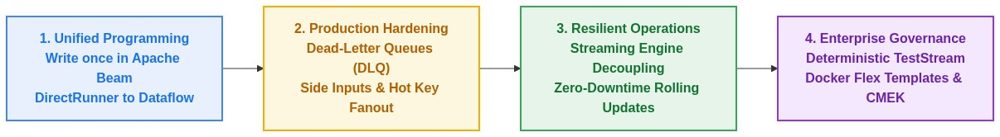
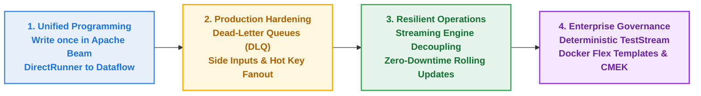
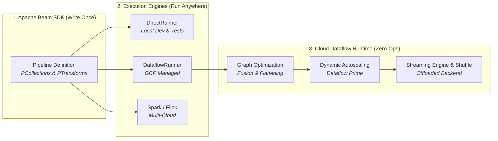
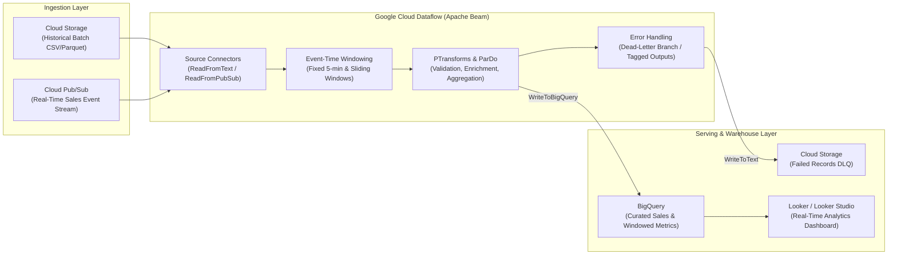
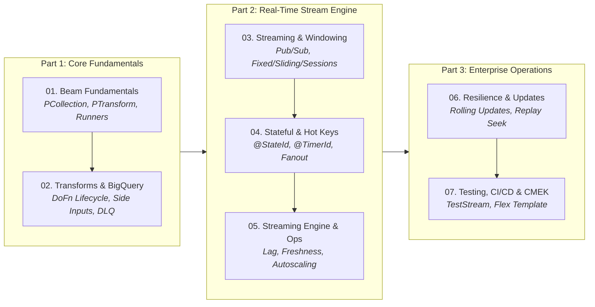

# Google Cloud Dataflow & Apache Beam Workshop

[](https://beam.apache.org/)
[](https://cloud.google.com/dataflow)
[](https://cloud.google.com/pubsub)
[](https://cloud.google.com/bigquery)
[](https://www.python.org/)
[](https://docs.astral.sh/uv/)
[](https://www.docker.com/)
[](https://cloud.google.com/build)


> **Google Cloud Modern Data Engineering Series**
> * **Stream & Serverless Processing Layer (This Repo):** [`dataflow-workshops`](https://github.com/EilinLux/dataflow-workshops) *(Unified Batch & Streaming Pipelines with Apache Beam, Streaming Engine & Flex Templates)*
> * **Compute Layer:** [`dataproc-workshop`](https://github.com/EilinLux/dataproc-workshop) *(Developing PySpark ETL jobs & `utils.py` on Dataproc Clusters and Dataproc Serverless)*
> * **Orchestration Layer:** [`composer-workshop`](https://github.com/EilinLux/composer-workshop) *(Scheduling, Deferrable Sensors, BigQuery Quality Gates & Local `DagBag` Testing with Cloud Composer 3)*
> * **Production CI/CD Blueprint:** [`CiCdAirFlowDagTemplate`](https://github.com/EilinLux/CiCdAirFlowDagTemplate) *(Automated Cloud Build CI/CD pipelines for testing & syncing DAGs to Cloud Composer)*

---

## Workshop Presentation

### Executive Overview

Welcome to the **Google Cloud Dataflow & Apache Beam Workshop**—a comprehensive, hands-on curriculum built for data engineers, streaming architects, and cloud practitioners.

In distributed data processing, most online tutorials rely on simplistic `wordcount` examples that fail when faced with real-world scale. Production systems do not operate in a vacuum of clean, well-behaved data; they encounter network delays, out-of-order event arrivals, catastrophic hot key skew, worker memory leaks, poison pill crashes, and strict enterprise security constraints.

This workshop provides a production-grade blueprint modeling **OmniRetail**, an omnichannel commerce enterprise processing millions of transactions per day. Across **7 progressive chapters**, you will navigate real production crises and implement the battle-tested architectural patterns required to solve them—progressing from local workstation development (`DirectRunner`) to Google Cloud serverless streaming (`DataflowRunner`).

---

### What Makes This Workshop Unique?



<details>
<summary><b>Click to expand raw Mermaid flowchart definition</b></summary>



</details>

| Dimension | Standard Online Tutorials | This Enterprise Workshop |
| :--- | :--- | :--- |
| **Data Realism** | Static text files with trivial words | High-throughput e-commerce transactions, malformed JSON/CSV, POS logs |
| **Execution Model** | Batch-only or isolated streams | **Unified Beam Model**: seamless transition from batch to unbounded streaming |
| **Failure Handling** | Ignored (assumes 100% clean data) | **Active chaos mitigation**: poison pills, late data, key skew, OOM prevention |
| **Data Enrichment** | Costly distributed joins (`CoGroupByKey`) | Broadcast **Side Inputs** (`beam.pvalue.AsDict`) for $O(1)$ zero-shuffle lookups |
| **State & Windowing** | Basic fixed 5-minute windows | Fixed (tumbling), sliding, session windows, stateful `@StateId`, and `@TimerId` |
| **Stream Operations** | Destructive job cancellation | **Zero-downtime rolling updates (`--update`)**, isolated Pub/Sub seek backfills |
| **Production Security** | Default public IPs & default keys | **Private IPs** (`--no-use-public-ips`), Private Google Access, and **Cloud KMS CMEK** |
| **Automation & CI/CD** | Ad-hoc manual terminal runs | Containerized **Flex Templates** on Artifact Registry and **Cloud Build** CI/CD |

---

### Target Audience & Learning Outcomes

* **Target Roles**: Senior Data Engineers, Analytics Engineers, Cloud Solutions Architects, and Platform Infrastructure Engineers.
* **Prerequisites**: Familiarity with Python (functions, generators, dicts) and general distributed systems concepts. No prior Apache Beam or Dataflow experience is required.
* **What You Will Walk Away With**:
  1. **Complete Reference Architecture**: 7 production pipelines and test suites ready to adapt directly for enterprise projects.
  2. **Beam Programming Fluency**: In-depth mastery of Beam core primitives (`PCollection`, `PTransform`, `DoFn`, `CombinePerKey`, `WindowInto`, `TestStream`).
  3. **Cloud Dataflow Mastery**: Decoupled state management via **Streaming Engine**, Pub/Sub Ordering Keys, BigQuery **Storage Write API**, and Cloud Monitoring SLA alerts.
  4. **Enterprise Governance Skills**: Packaging pipelines into Docker Flex Templates, automating unit and streaming tests, and satisfying SOC2/PCI-DSS compliance via VPC isolation and CMEK encryption.

---

### Workshop Curriculum & Delivery Format

Every chapter in this workshop follows a standardized four-part delivery format:
1. **Interactive Jupyter Notebook (`.ipynb`)**: For rapid visual exploration, step-by-step experimentation, and DAG inspection with pre-rendered diagrams.
2. **Modular Production Script (`pipelines/`)**: Clean, CLI-configurable Python pipelines using industry-standard flags.
3. **Execution Shell Scripts (`scripts/`)**: Pre-configured one-click scripts for local testing (`DirectRunner`) and cloud deployment (`DataflowRunner`).
4. **Comprehensive Documentation (`README.md`)**: Complete architectural deep dives, visual diagrams, failure mode case studies, and official Google Cloud documentation links.

```text
01_beam_fundamentals/               -> From Single-Node Pandas to Distributed Beam
02_transforms_and_bigquery/         -> Broadcast Side Inputs & Dead-Letter Queues (DLQ)
03_realtime_streaming/              -> Pub/Sub Unbounded Streams & 3 Window Topologies
04_stateful_processing_and_hotkeys/ -> Hot Key Fanout & Inactivity State Timers
05_streaming_engine_and_monitoring/ -> Streaming Engine & Cloud Monitoring SLA Alerts
06_operations_replay_and_updates/   -> In-Place Rolling Updates & 24h Disaster Recovery
07_testing_templates_and_cicd/      -> TestStream, Docker Flex Templates, CI/CD & CMEK
```

---

## What is Google Cloud Dataflow?

Modern data engineering demands processing both historical bounded data (daily batch files, warehouse extracts) and continuous unbounded data (clickstreams, IoT telemetry, real-time financial transactions). Historically, teams had to maintain two completely separate architectures: one engine for batch (like Hadoop/Spark) and another for streaming (like Storm/Flink)—an anti-pattern known as the **Lambda Architecture**, which resulted in duplicate pipeline logic, disparate APIs, and synchronization nightmares.

**Google Cloud Dataflow** solves this challenge. It is Google Cloud's fully managed, serverless, horizontally auto-scaling execution service for running unified stream and batch pipelines written in **Apache Beam**.



With Dataflow, you define your pipeline logic using the open-source **Apache Beam SDK** and deploy it to Google Cloud. Dataflow automatically provisions compute resources, balances workloads dynamically across worker VMs, integrates natively with Google Cloud managed storage services, and tears down infrastructure when batch jobs finish—or scales horizontally to absorb unpredictable streaming traffic spikes with millisecond latency.

---
## Table of Contents

- [Workshop Presentation](#workshop-presentation)
  - [Executive Overview](#executive-overview)
  - [What Makes This Workshop Unique?](#what-makes-this-workshop-unique)
  - [Target Audience & Learning Outcomes](#target-audience--learning-outcomes)
  - [Workshop Curriculum & Delivery Format](#workshop-curriculum--delivery-format)
- [What is Google Cloud Dataflow?](#what-is-google-cloud-dataflow)
- [Core Pillars of Google Cloud Dataflow](#core-pillars-of-google-cloud-dataflow)
  - [1. Unified Batch and Streaming with Apache Beam](#1-unified-batch-and-streaming-with-apache-beam)
  - [2. True Serverless & Zero-Ops Management](#2-true-serverless--zero-ops-management)
  - [3. Dynamic Work Rebalancing (Liquid Shuffling)](#3-dynamic-work-rebalancing-liquid-shuffling)
  - [4. Decoupled Compute and State: Streaming Engine & Dataflow Shuffle](#4-decoupled-compute-and-state-streaming-engine--dataflow-shuffle)
  - [5. Robust Exactly-Once Semantics & Event-Time Processing](#5-robust-exactly-once-semantics--event-time-processing)
  - [6. Dataflow Templates & Flex Templates](#6-dataflow-templates--flex-templates)

- [End-to-End Workshop Pipeline Architecture](#end-to-end-workshop-pipeline-architecture)
- [The Workshop Storyline: From Local Beam to Enterprise Streaming](#the-workshop-storyline-from-local-beam-to-enterprise-streaming)
  - [Chapter 01 — Apache Beam & Dataflow Fundamentals](01_beam_fundamentals/)
  - [Chapter 02 — Deep Dive into PTransforms & BigQuery I/O](02_transforms_and_bigquery/)
  - [Chapter 03 — Real-Time Streaming, Windowing & Late Data](03_realtime_streaming/)
  - [Chapter 04 — Stateful Processing, Timers & Hot Key Fanout](04_stateful_processing_and_hotkeys/)
  - [Chapter 05 — Production Performance, Streaming Engine & Observability](05_streaming_engine_and_monitoring/)
  - [Chapter 06 — Resilient Operations, Disaster Recovery & Rolling Updates](06_operations_replay_and_updates/)
  - [Chapter 07 — Unit Testing, Docker Flex Templates, CI/CD & Security](07_testing_templates_and_cicd/)
- [Repository Structure](#repository-structure)
- [Apache Beam & Dataflow Core Concepts Quick Reference](#apache-beam--dataflow-core-concepts-quick-reference)
- [Environment Setup & Activating the Kernel with uv](#environment-setup--activating-the-kernel-with-uv)
  - [1. Install `uv`](#1-install-uv-if-not-already-installed)
  - [2. Create or Synchronize the Virtual Environment](#2-create-or-synchronize-the-virtual-environment-uv-sync)
  - [3. How to Activate the Environment](#3-how-to-activate-the-environment)
- [Google Cloud Prerequisites & Quick Start](#google-cloud-prerequisites--quick-start)
  - [1. Authenticate and Configure GCP Project](#1-authenticate-and-configure-gcp-project)
  - [2. Enable Required APIs](#2-enable-required-apis)
  - [3. Create Cloud Storage Buckets](#3-create-cloud-storage-buckets)
  - [4. Create and Configure Local `.env`](#4-create-and-configure-local-env)
- [Official Documentation & Deep Dives](#official-documentation--deep-dives)
- [Dataflow vs. Dataproc: When to Use What?](#dataflow-vs-dataproc-when-to-use-what)

---

## Core Pillars of Google Cloud Dataflow

### 1. Unified Batch and Streaming with Apache Beam
Apache Beam (combining **B**atch + Str**eam**) provides a single API where bounded and unbounded datasets are represented by the exact same primitive: a **`PCollection`**. 
- In **Batch Mode**, the `PCollection` represents a fixed, bounded dataset (e.g., historical Parquet/CSV files on Cloud Storage or a BigQuery table partition).
- In **Streaming Mode**, the `PCollection` represents an infinite, unbounded stream of events arriving from message brokers like **Cloud Pub/Sub** or **Apache Kafka**.

⚠️ **Switching a pipeline from batch to streaming** often requires changing only the source connector and defining an event-time windowing strategy.

### 2. True Serverless & Zero-Ops Management
Traditional distributed compute (such as standalone Spark or Flink clusters) requires teams to size master/worker nodes, configure memory limits, patch operating systems, and tune cluster yarn parameters. Dataflow abstracts all infrastructure:
- **No Cluster Sizing**: You never configure cluster topologies or master nodes.
- **Fast Startup & Instant Scale-Down**: Batch workers spin up on demand and shut down immediately upon pipeline completion, ensuring you only pay for the exact compute seconds consumed.
- **Managed Autoscaling**: Dataflow continuously monitors throughput, backlog size, and CPU utilization, automatically adding or removing worker VMs in real time.

### 3. Dynamic Work Rebalancing (Liquid Shuffling)
In traditional MapReduce and Spark jobs, straggling tasks (caused by uneven data splits, slow worker nodes, or key skew) can hold up an entire stage for hours. Dataflow continuously inspects the processing rate of every worker. If one worker is lagging behind, Dataflow dynamically splits the remaining unprocessed portion of that worker's work item and redistributes it to an idle worker—without failing or restarting the task.

### 4. Decoupled Compute and State: Streaming Engine & Dataflow Shuffle
Dataflow separates compute workers from shuffle and state management:
* **Dataflow Shuffle (for Batch)**: Moves the execution of shuffle operations (such as `GroupByKey` and `CoGroupByKey`) off worker disks and memory into a dedicated Google-managed shuffle service, accelerating batch jobs and reducing worker memory pressure.
* **Streaming Engine (for Streaming)**: Offloads window state storage and streaming shuffle processing from worker VMs to a purpose-built backend service. This drastically reduces worker VM memory footprint, accelerates autoscaling responsiveness, and provides smoother latency profiles.

### 5. Robust Exactly-Once Semantics & Event-Time Processing
Dataflow natively handles out-of-order data, late-arriving records, and network retries:
* **Event Time vs. Processing Time**: Pipelines reason about data based on when the event actually occurred in the physical world (`Event Time`), rather than when the data arrived at the cloud ingestion service (`Processing Time`).
* **Watermarks**: Monotonically advancing timestamps that track the system's progress and estimate when all data up to a given event timestamp has been observed.
* **Windowing & Triggers**: Flexible temporal grouping—**Fixed (Tumbling)**, **Sliding (Hopping)**, and dynamic user activity **Session Windows**—paired with custom triggers and allowed lateness for deterministic downstream BigQuery / Cloud Storage writes.

### 6. Dataflow Templates & Flex Templates
Dataflow simplifies enterprise operations through containerized **Flex Templates**:
* Developers package Beam pipelines inside standard Docker containers and store the template specification in Cloud Storage.
* Non-developers, automated CI/CD pipelines, or orchestration engines (such as **Cloud Composer / Apache Airflow**) can trigger jobs with custom runtime parameters via the `gcloud` CLI, REST API, or Cloud Console without needing a local Python/Java development environment.


---

## End-to-End Workshop Pipeline Architecture

In this workshop, you will build and deploy a production-grade, enterprise retail streaming and batch data processing platform on Google Cloud:



---

## The Workshop Storyline: From Local Beam to Enterprise Streaming

This workshop is structured as a hands-on, progressive curriculum taking you from zero to production Dataflow expertise:



This workshop follows the engineering journey of **OmniRetail**, a global omnichannel commerce platform scaling from fragile batch jobs to a resilient, enterprise-grade streaming architecture:

### Chapter 01 — The Batch Reconciliation Starting Line (`01_beam_fundamentals/`)
* **The Business Crisis**: Nightly store reconciliation scripts written in single-node pandas crash with `MemoryError` when sales logs hit 50GB, causing the finance team to miss their 6:00 AM executive reporting deadline.
* **The Production Solution**: Adopt the **Apache Beam** distributed computing model. Build an auto-scaling batch pipeline with `beam.io.ReadFromText`, custom `DoFn` parsing, and `CombinePerKey` local combining, runnable on `DirectRunner` locally and Google Cloud `DataflowRunner` in production.
* **Storyline Connection**: With batch scaling solved, marketing launches a product catalog, but incoming sales files now contain malformed records and unmapped IDs that silently crash the nightly run.

### Chapter 02 — Dimension Enrichment & The Poison Pill Crisis (`02_transforms_and_bigquery/`)
* **The Business Crisis**: Finance demands every sale be enriched with live catalog dimensions (profit margins, categories). A naive `CoGroupByKey` join shuffles gigabytes of data across workers, exploding cloud costs. Worse, a single corrupt record (`amount: -45.00`) causes worker crash loops, failing the entire 4-hour batch job.
* **The Production Solution**: Broadcast the reference dimension catalog to workers as an in-memory **Side Input** (`beam.pvalue.AsDict`) for $O(1)$ lookups without shuffle overhead. Implement **Tagged Multi-Outputs** to route valid records to BigQuery via the **Storage Write API** while isolating poison pills to a Cloud Storage **Dead-Letter Queue (DLQ)** with zero downtime.
* **Storyline Connection**: Batch ingestion is now crash-proof and enriched. But Black Friday arrives, and waiting for midnight batch reports means inventory stock-outs and fraudulent purchases are discovered 24 hours too late.

### Chapter 03 — Black Friday Flash Sales — The Real-Time Streaming Pivot (`03_realtime_streaming/`)
* **The Business Crisis**: Black Friday flash sales hit 50,000 orders/minute. Fraud bots purchase sneaker inventory in seconds, while mobile network latency causes orders to arrive minutes out-of-order. Waiting for midnight batch files means fraudulent orders ship before they are flagged.
* **The Production Solution**: Pivot to unbounded stream processing with **Google Cloud Pub/Sub** and **Ordering Keys**. Implement event-time windowing to answer the 4 questions: **Fixed (Tumbling)** 60s windows for volume, **Sliding** 60s/20s moving velocity, and **Session Windows** for user burst tracking, using **Watermarks** and **Triggers** to gracefully handle late-arriving data.
* **Storyline Connection**: The stream engine processes events continuously. But suddenly, a mega-influencer shares a product link, concentrating 80% of platform traffic on a single key while shopping cart memory leaks crash worker VMs!

### Chapter 04 — The Celebrity Influencer Disaster & Session State Leaks (`04_stateful_processing_and_hotkeys/`)
* **The Business Crisis**: A top influencer with 80M followers posts an endorsement. 100,000 events/second route to a single user key (`usr_hot_influencer`). Dataflow routes all traffic for that key to a **single worker VM**, causing CPU exhaustion and the fatal Dataflow error: `A hot key was detected in step...`. Meanwhile, storing per-user carts without cleanup leaks memory until workers crash.
* **The Production Solution**: Eliminate the hot key bottleneck using **`CombinePerKey().withHotKeyFanout(10)`**, dynamically salting traffic across 10 intermediate workers for local pre-aggregation. Implement per-key persistent state using **Stateful `DoFn`** (`@StateId`), with **Automated State Expiration Timers** (`@TimerId`) to flush cart profiles and garbage-collect memory upon inactivity.
* **Storyline Connection**: The pipeline absorbs severe key skew without breaking a sweat. But on Cyber Monday, the executive dashboard suddenly goes blank, revenue numbers are 20 minutes stale, and persistent disk shuffle is thrashing worker VMs.

### Chapter 05 — The "Black Screen" Crisis — Streaming Engine & Observability (`05_streaming_engine_and_monitoring/`)
* **The Business Crisis**: Cyber Monday 2:00 PM: The executive dashboard shows stale numbers, and alarms go off. Are orders dropping? Is Pub/Sub backlogged? Workers are pinned at 100% disk IOPS due to local persistent disk shuffle thrashing, inflating monthly cloud bills.
* **The Production Solution**: Decouple compute from state storage by enabling **Dataflow Streaming Engine** (`--enable_streaming_engine`), offloading state and shuffle to Google-managed infrastructure so stateless VMs can autoscale in seconds. Profile step latency with Beam `Metrics.distribution`, and deploy **Cloud Monitoring Alert Policies** to distinguish between **System Lag** (processing backlog) and **Data Freshness** (output record age).
* **Storyline Connection**: The pipeline runs with optimized Streaming Engine and SLA observability. Then, a production emergency strikes: a critical tax calculation bug is deployed, and we must patch the running pipeline and re-process the past 24 hours without customer downtime!

### Chapter 06 — Production Fire Drill — In-Place Updates & 24h Disaster Recovery (`06_operations_replay_and_updates/`)
* **The Business Crisis**: An audit reveals a tax calculation defect in production. Canceling the pipeline causes customer checkout timeouts, while restarting it loses in-flight state. Furthermore, we must re-calculate 24 hours of corrupted transactions without duplicating live production orders.
* **The Production Solution**: Execute a **Zero-Downtime In-Place Rolling Update** (`gcloud dataflow jobs run --update`) with verified transform name compatibility, seamlessly draining V1 in-flight bundles while routing new events to V2. Execute disaster recovery by creating an isolated Pub/Sub recovery subscription, **seeking** to $T - 24\text{h}$, backfilling to a BigQuery staging table, and performing an atomic partition swap with zero live customer impact.
* **Storyline Connection**: Live upgrades and historical disaster recovery are battle-tested. Finally, the CISO and enterprise compliance team step in: running manual shell scripts with public IPs and default encryption fails regulatory audits!

### Chapter 07 — Enterprise Governance, Security Hardening & Automated CI/CD (`07_testing_templates_and_cicd/`)
* **The Business Crisis**: Corporate security blocks deployment: worker VMs have public IPs exposed to the internet, disks lack Customer-Managed Encryption Keys (CMEK), and manual script deployments lack automated unit testing—failing SOC2 and PCI-DSS compliance audits.
* **The Production Solution**: Implement deterministic quality engineering using **`TestPipeline`**, **`PAssert`**, and **`TestStream`** (testing streaming watermarks without GCP dependencies). Package pipelines into containerized **Dataflow Flex Templates** on **Artifact Registry**, automate testing and deployment with **Cloud Build**, and lock down security using **Private IPs** (`--no-use-public-ips`), Private Google Access, and **Cloud KMS CMEK encryption** (`--dataflow_kms_key`).

---

## Repository Structure

```text
dataflow-workshops/
├── .env.example                                      # Template with GCP, Dataflow & BigQuery variables
├── .env                                              # Local environment variables (git-ignored)
├── pyproject.toml                                    # Python dependencies managed with uv
├── uv.lock                                           # Locked dependency resolution
├── README.md                                         # Main workshop index & comprehensive Dataflow guide
│
├── 01_beam_fundamentals/                             # Chapter 01: Apache Beam & Dataflow Fundamentals
│   ├── README.md                                     # Chapter documentation & execution guide
│   ├── 01_beam_fundamentals.ipynb                    # Interactive notebook covering Beam model & local/cloud runs
│   ├── data/
│   │   └── sales_data.csv                            # Sample retail transactions dataset
│   ├── pipelines/
│   │   └── sales_pipeline.py                         # Production-grade Beam pipeline script (Direct & Dataflow)
│   └── scripts/
│       ├── 01_run_local.sh                           # Local execution script (DirectRunner)
│       └── 02_run_dataflow.sh                        # Cloud Dataflow submission script (DataflowRunner)
│
├── 02_transforms_and_bigquery/                       # Chapter 02: Advanced Transforms, Side Inputs & BigQuery I/O
│   ├── README.md                                     # Chapter documentation, architecture & quick start
│   ├── 02_transforms_and_bigquery.ipynb              # Interactive notebook with DoFn lifecycle, Side Inputs & DLQ
│   ├── data/
│   │   ├── sales_data_with_errors.csv                # Sales data with valid and intentional poison rows
│   │   └── product_catalog.json                      # Reference product catalog for Side Input lookup
│   ├── pipelines/
│   │   └── enrich_and_load_bq.py                     # Production pipeline (Storage Write API & DLQ)
│   └── scripts/
│       ├── 01_run_local.sh                           # Local execution script (DirectRunner)
│       └── 02_run_dataflow.sh                        # Cloud Dataflow submission script (DataflowRunner)
│
├── 03_realtime_streaming/                            # Chapter 03: Real-Time Pub/Sub Streaming, Windowing & Late Data
│   ├── README.md                                     # Chapter documentation & windowing guide
│   ├── 03_realtime_streaming.ipynb                   # Interactive notebook with Tumbling, Sliding & Session Windows
│   ├── data/
│   │   └── sample_events.json                        # Synthetic telemetry stream (valid, late, poison records)
│   ├── pipelines/
│   │   └── streaming_windowing_pipeline.py           # Production streaming pipeline with Pub/Sub & BigQuery
│   └── scripts/
│       ├── 01_run_local.sh                           # Local streaming simulation script (DirectRunner)
│       ├── 02_run_dataflow.sh                        # DataflowRunner streaming submission script
│       └── generate_streaming_data.py                # Pub/Sub streaming publisher with timestamps & drift
│
├── 04_stateful_processing_and_hotkeys/               # Chapter 04: Stateful Processing, Timers & Hot Key Fanout
│   ├── README.md                                     # Chapter documentation & hot key guide
│   ├── 04_stateful_processing_and_hotkeys.ipynb      # Interactive notebook with stateful DoFns & fanout
│   ├── data/
│   │   └── skewed_clickstream.json                   # Skewed telemetry stream (500 celebrity events vs 5 normal)
│   ├── pipelines/
│   │   └── stateful_and_fanout_pipeline.py           # Production pipeline with @StateId, @TimerId & withHotKeyFanout
│   └── scripts/
│       ├── 01_run_local.sh                           # Local execution script (DirectRunner)
│       └── 02_run_dataflow.sh                        # Cloud Dataflow submission script
│
├── 05_streaming_engine_and_monitoring/               # Chapter 05: Production Performance, Streaming Engine & Observability
│   ├── README.md                                     # Chapter documentation & monitoring guide
│   ├── 05_streaming_engine_and_monitoring.ipynb      # Interactive notebook with metrics & latency profiling
│   ├── data/
│   │   └── benchmark_telemetry.json                  # High-volume synthetic benchmark stream
│   ├── pipelines/
│   │   └── benchmarked_streaming_pipeline.py         # Pipeline with Beam Metrics.distribution & Streaming Engine
│   ├── monitoring/
│   │   ├── alert_policy_system_lag.json              # Cloud Monitoring SLA Alert Policy (System Lag > 120s)
│   │   ├── alert_policy_data_freshness.json          # Cloud Monitoring Alert Policy (Data Freshness > 300s)
│   │   └── dashboard_dataflow_sla.json               # Cloud Monitoring Dashboard configuration
│   └── scripts/
│       ├── 01_run_local_benchmark.sh                 # Local benchmark runner (DirectRunner)
│       └── 02_run_dataflow_optimized.sh              # Cloud submission script with autoscaling
│
├── 06_operations_replay_and_updates/                 # Chapter 06: Resilient Operations, Disaster Recovery & Rolling Updates
│   ├── README.md                                     # Chapter documentation & recovery guide
│   ├── 06_operations_replay_and_updates.ipynb        # Interactive notebook with rolling updates & seek
│   ├── data/
│   │   └── replay_telemetry.json                     # 24-hour historical telemetry stream
│   ├── pipelines/
│   │   ├── resilient_stream_v1.py                    # Pipeline Version 1 (Baseline logic)
│   │   └── resilient_stream_v2.py                    # Pipeline Version 2 (In-place rolling update)
│   └── scripts/
│       ├── 01_test_rolling_update_simulation.sh      # Local simulation comparing V1 vs V2
│       ├── 02_deploy_v1_and_update_v2.sh             # Zero-downtime rolling update submission
│       └── 03_disaster_recovery_seek_replay.sh       # Disaster recovery via Pub/Sub subscription seek
│
├── 07_testing_templates_and_cicd/                    # Chapter 07: Unit Testing, Docker Flex Templates, CI/CD & Security
│   ├── README.md                                     # Chapter documentation & security guide
│   ├── 07_testing_templates_and_cicd.ipynb           # Interactive notebook with TestStream, Flex Templates & CMEK
│   ├── tests/
│   │   ├── test_transforms.py                        # Deterministic unit tests (TestPipeline & assert_that)
│   │   └── test_streaming_teststream.py              # Streaming unit tests (TestStream watermark testing)
│   ├── template/
│   │   ├── Dockerfile                                # Flex Template container definition
│   │   ├── metadata.json                             # Template parameters specification
│   │   └── requirements.txt                          # Container dependencies
│   ├── cicd/
│   │   └── cloudbuild.yaml                           # Automated Cloud Build CI/CD pipeline
│   ├── pipelines/
│   │   └── secure_orders_pipeline.py                 # Pipeline with CMEK, Private IPs, and VPC controls
│   └── scripts/
│       ├── 01_run_unit_tests.sh                      # Local unit test runner (pytest)
│       ├── 02_build_flex_template.sh                 # Docker build & Artifact Registry push
│       └── 03_run_secure_flex_template.sh            # Secure execution with Private IPs & CMEK
│
└── artifacts/                                        # Pre-rendered high-res SVG & PNG pipeline architecture diagrams
    ├── 01_numbers_pipeline_dag.png
    ├── 01_sales_pipeline_dag.png
    ├── 02_side_inputs_and_bq_dag.png
    ├── 03_windowing_and_streaming_dag.png
    ├── 04_stateful_and_fanout_dag.png
    ├── 05_streaming_engine_and_monitoring_dag.png
    ├── 06_resilient_ops_and_updates_dag.png
    └── 07_testing_templates_and_cicd_dag.png
```

---

## Apache Beam & Dataflow Core Concepts Quick Reference

A complete reference of all fundamental abstractions, streaming primitives, stateful operators, observability metrics, and enterprise security patterns demonstrated throughout this repository:

| Concept | Chapter / Folder | Category | Description | Production Code Example |
| :--- | :--- | :--- | :--- | :--- |
| **`Pipeline` & `PipelineOptions`** | [`01_beam_fundamentals/`](01_beam_fundamentals/) | Core Abstraction | Root directed acyclic graph (DAG) container configured with runner, worker, and GCP project options. | `with beam.Pipeline(options=PipelineOptions()) as p:` |
| **`PCollection`** | [`01_beam_fundamentals/`](01_beam_fundamentals/) | Core Abstraction | Immutable distributed dataset representing bounded batch or unbounded streaming data. | `lines = p \| "Read" >> beam.io.ReadFromText("gs://...")` |
| **`PTransform`** | [`01_beam_fundamentals/`](01_beam_fundamentals/) | Core Abstraction | Data transformation step piped with `\|` and assigned a unique step name using `>>`. | `output = input \| "StepLabel" >> CustomTransform()` |
| **`DirectRunner` vs `DataflowRunner`** | [`01_beam_fundamentals/`](01_beam_fundamentals/) | Execution Engines | Local in-memory runner for debugging/tests vs. Google Cloud zero-ops distributed serverless service. | `--runner=DataflowRunner --project=$PROJECT_ID` |
| **`Map` & `FlatMap`** | [`01_beam_fundamentals/`](01_beam_fundamentals/) | Element-wise | Functional transforms for 1-to-1 element mapping or 1-to-many list flattening without state. | `words = lines \| "Split" >> beam.FlatMap(lambda x: x.split())` |
| **`Filter`** | [`01_beam_fundamentals/`](01_beam_fundamentals/) | Element-wise | Predicate-based element filtering evaluating each record to True or False. | `valid = records \| "Filter" >> beam.Filter(lambda x: x["amt"] > 0)` |
| **`DoFn` Lifecycle** | [`02_transforms_and_bigquery/`](02_transforms_and_bigquery/) | Custom Processing | Distributed worker class lifecycle hooks: `setup()`, `process()`, `finish_bundle()`, `teardown()`. | `class ProcessFn(beam.DoFn): def setup(self): ...` |
| **Side Inputs (`AsDict`, `AsList`)** | [`02_transforms_and_bigquery/`](02_transforms_and_bigquery/) | Cross-Data Lookup | Broadcasting auxiliary lookup collections to all worker DoFns without cross-cluster join shuffles. | `pcoll \| beam.ParDo(EnrichFn(), cat=beam.pvalue.AsDict(cat_pcoll))` |
| **Tagged Outputs (`TaggedOutput` / DLQ)** | [`02_transforms_and_bigquery/`](02_transforms_and_bigquery/) | Multi-Branching | Routing malformed or failed records to an isolated dead-letter queue while good data continues. | `yield beam.pvalue.TaggedOutput("dead_letter", error_record)` |
| **BigQuery Storage Write API** | [`02_transforms_and_bigquery/`](02_transforms_and_bigquery/) | Managed I/O Sink | High-throughput, low-latency append stream writing directly into BigQuery with exactly-once guarantees. | `beam.io.WriteToBigQuery(table, method="STORAGE_WRITE_API")` |
| **Pub/Sub Stream Ingestion** | [`03_realtime_streaming/`](03_realtime_streaming/) | Stream Ingestion | Ingesting unbounded streaming messages with message ordering keys and publish timestamps. | `p \| beam.io.ReadFromPubSub(subscription=sub_path)` |
| **Event Timestamps & Watermarks** | [`03_realtime_streaming/`](03_realtime_streaming/) | Time Semantics | Attaching event-time timestamps (`TimestampedValue`) and advancing watermark clocks across steps. | `beam.window.TimestampedValue(record, epoch_timestamp)` |
| **Fixed (Tumbling) Windows** | [`03_realtime_streaming/`](03_realtime_streaming/) | Windowing | Segmenting stream elements into continuous, non-overlapping uniform intervals (e.g., 60-second buckets). | `pcoll \| beam.WindowInto(FixedWindows(60))` |
| **Sliding (Hopping) Windows** | [`03_realtime_streaming/`](03_realtime_streaming/) | Windowing | Overlapping uniform intervals for continuous rolling aggregates and moving rate averages. | `pcoll \| beam.WindowInto(SlidingWindows(size=300, period=60))` |
| **Session Windows** | [`03_realtime_streaming/`](03_realtime_streaming/) | Windowing | Dynamic per-key activity windows demarcated by periods of inactivity exceeding a gap threshold. | `pcoll \| beam.WindowInto(Sessions(gap_size=300))` |
| **Allowed Lateness & Accumulation** | [`03_realtime_streaming/`](03_realtime_streaming/) | Time Semantics | Retaining window state beyond watermark to process late arrivals and update existing aggregations. | `allowed_lateness=86400, accumulation_mode=AccumulationMode.ACCUMULATING` |
| **Watermark Triggers** | [`03_realtime_streaming/`](03_realtime_streaming/) | Window Triggers | Specifying early speculative firings, on-time watermark firings, and late-arriving delta firings. | `trigger=AfterWatermark(early=AfterCount(10), late=AfterCount(1))` |
| **Stateful `DoFn` (`@StateId`)** | [`04_stateful_processing_and_hotkeys/`](04_stateful_processing_and_hotkeys/) | Stateful Processing | Managing per-key persistent state (`ReadModifyWriteStateSpec`, `BagStateSpec`) offloaded to Streaming Engine. | `COUNT_STATE = ReadModifyWriteStateSpec("count", VarIntCoder())` |
| **Timers & Callbacks (`@TimerId`)** | [`04_stateful_processing_and_hotkeys/`](04_stateful_processing_and_hotkeys/) | Stateful Processing | Scheduling event-time or processing-time callbacks to flush buffers or purge inactive state. | `EXPIRY_TIMER = TimerSpec("expiry", TimeDomain.REAL_TIME)` |
| **Hot Key Fanout (`withHotKeyFanout`)** | [`04_stateful_processing_and_hotkeys/`](04_stateful_processing_and_hotkeys/) | Skew Mitigation | Sharding skewed/popular keys across $N$ intermediate workers before global combiner reduction. | `pcoll \| beam.CombinePerKey(sum).withHotKeyFanout(10)` |
| **Pipeline Metrics (`Metrics.distribution`)** | [`05_streaming_engine_and_monitoring/`](05_streaming_engine_and_monitoring/) | Observability | Tracking custom counters, gauges, and step latency distributions visible in Cloud Dataflow & Monitoring. | `self.dist = Metrics.distribution(self.__class__, "step_latency_ms")` |
| **Streaming Engine & Managed Shuffle** | [`05_streaming_engine_and_monitoring/`](05_streaming_engine_and_monitoring/) | Cloud Infrastructure | Offloading window state, timers, and shuffle operations from worker VMs to dedicated Google backend. | `--enable_streaming_engine --experiments=use_runner_v2` |
| **System Lag & Data Freshness** | [`05_streaming_engine_and_monitoring/`](05_streaming_engine_and_monitoring/) | Observability | Core Dataflow SLA metrics measuring backlog processing latency vs. source data generation age. | `monitoring/alert_policy_system_lag.json` |
| **In-Place Rolling Updates (`--update`)** | [`06_operations_replay_and_updates/`](06_operations_replay_and_updates/) | Resilient Operations | Upgrading running streaming pipelines with zero downtime, preserving in-flight state and offsets. | `gcloud dataflow jobs run --update --job-name=$JOB_NAME` |
| **Pub/Sub Subscription Seek & Replay** | [`06_operations_replay_and_updates/`](06_operations_replay_and_updates/) | Disaster Recovery | Rewinding subscriber stream offsets to backfill historical timestamps without impacting production. | `gcloud pubsub subscriptions seek SUB --time="2026-10-24T12:00:00Z"` |
| **Pub/Sub Dead-Letter Topics** | [`06_operations_replay_and_updates/`](06_operations_replay_and_updates/) | Failure Defense | Quarantining poison pills that exceed `max_delivery_attempts` to prevent worker crash loops. | `gcloud pubsub subscriptions update SUB --dead-letter-topic=TOPIC` |
| **Deterministic Unit Testing (`TestPipeline`)**| [`07_testing_templates_and_cicd/`](07_testing_templates_and_cicd/) | Testing & CI/CD | In-memory pipeline runner with `assert_that` and `equal_to` matchers for fast unit tests. | `with TestPipeline() as p: assert_that(output, equal_to([...]))` |
| **Unbounded Stream Testing (`TestStream`)** | [`07_testing_templates_and_cicd/`](07_testing_templates_and_cicd/) | Testing & CI/CD | Programmatically injecting elements, advancing watermarks, and firing triggers deterministically. | `TestStream().advance_watermark_to(100).add_elements([e1])` |
| **Dataflow Flex Templates** | [`07_testing_templates_and_cicd/`](07_testing_templates_and_cicd/) | Deployment | Packaging containerized pipelines into standard Docker images on Artifact Registry. | `gcloud dataflow flex-template build gs://.../spec.json --image=...` |
| **Private IPs & VPC Network Isolation** | [`07_testing_templates_and_cicd/`](07_testing_templates_and_cicd/) | Enterprise Security | Preventing public internet exposure on worker VMs using Private Google Access and custom subnets. | `--no_use_public_ips --subnetwork="https://www.googleapis.com/..."` |
| **Customer-Managed Encryption Keys (CMEK)** | [`07_testing_templates_and_cicd/`](07_testing_templates_and_cicd/) | Enterprise Security | Protecting persistent disks, temporary shuffle buckets, and BigQuery tables with Cloud KMS keys. | `--dataflow_kms_key="projects/.../cryptoKeys/..."` |


---

## Environment Setup & Activating the Kernel with uv

This project uses **[`uv`](https://docs.astral.sh/uv/)** to manage dependencies in an isolated `.venv` virtual environment.

### 1. Install `uv` (if not already installed)
```bash
# macOS / Linux:
curl -LsSf https://astral.sh/uv/install.sh | sh
# or via Homebrew:
brew install uv
```

### 2. Create or Synchronize the Virtual Environment (`uv sync`)
From the root of the repository, create the `.venv` and install all required dependencies:
```bash
# Synchronize dependencies from pyproject.toml into .venv
uv sync
```

### 3. How to Activate the Environment

#### Option A: In the Terminal
If you are running scripts from the command line, activate the environment with:
```bash
# macOS / Linux:
source .venv/bin/activate

# Windows (Command Prompt / PowerShell):
# .venv\Scripts\activate

# Or execute any command directly without manual activation:
uv run python 01_beam_fundamentals/pipelines/sales_pipeline.py --help
```
Once activated, your prompt will show `(.venv)` and running `python` or `pip` will automatically use the isolated environment. To deactivate when done, simply run `deactivate`.

#### Option B: In This Jupyter Notebook (Kernel Selection)
If you run a notebook cell and see:
```text
ModuleNotFoundError: No module named 'apache_beam'
```
the notebook is attached to your global system Python instead of the `.venv`.

1. **Register the kernel** (run this once from your terminal in the repository root):
   ```bash
   uv run python -m ipykernel install --user --name dataflow-workshops --display-name "Python (dataflow-workshops)"
   ```
2. **Select the kernel in your IDE**:
   * Look at the top-right corner of this notebook editor window.
   * Click the **Kernel Picker** button.
   * Select **`Python (dataflow-workshops)`** or browse to **`.venv/bin/python`**.

Once selected, all notebook cells will execute inside the isolated `.venv` environment with `apache-beam` and all Google Cloud SDKs available.

---

## Google Cloud Prerequisites & Quick Start

### 1. Authenticate and Configure GCP Project
```bash
# Authenticate CLI and Application Default Credentials
gcloud auth login
gcloud auth application-default login

# Configure your project and billing quota
PROJECT_ID="<YOUR_GCP_PROJECT_ID>"
gcloud config set project "$PROJECT_ID"
gcloud config set billing/quota_project "$PROJECT_ID"
gcloud auth application-default set-quota-project "$PROJECT_ID"
```

### 2. Enable Required APIs
```bash
gcloud services enable \
  dataflow.googleapis.com \
  compute.googleapis.com \
  storage.googleapis.com \
  bigquery.googleapis.com \
  pubsub.googleapis.com \
  artifactregistry.googleapis.com \
  cloudbuild.googleapis.com
```

### 3. Create Cloud Storage Buckets
Dataflow requires a Cloud Storage bucket for pipeline staging and temporary shuffle files:
```bash
BUCKET_NAME="${PROJECT_ID}-dataflow-storage"
REGION="europe-west1"

gcloud storage buckets create "gs://${BUCKET_NAME}" \
  --project="${PROJECT_ID}" \
  --location="${REGION}" \
  --uniform-bucket-level-access
```

### 4. Create and Configure Local `.env`
```bash
cp .env.example .env
# Edit .env with your PROJECT_ID, REGION, and BUCKET_NAME
```

---


## Official Documentation & Deep Dives

### Google Cloud Dataflow
* [Google Cloud Dataflow Documentation](https://cloud.google.com/dataflow/docs) — Official landing page and architectural guides.
* [Dataflow Streaming Engine Overview](https://cloud.google.com/dataflow/docs/guides/streaming-engine) — Cloud-managed shuffle and state offloading.
* [Dataflow Flex Templates Guide](https://cloud.google.com/dataflow/docs/guides/templates/overview#flex-templates) — Packaging containerized pipelines into reusable artifacts.
* [Dataflow Security: Private IPs and VPCs](https://cloud.google.com/dataflow/docs/guides/routes-firewall#private_ip) — Isolating worker VMs from public internet exposure.
* [Customer-Managed Encryption Keys (CMEK) for Dataflow](https://cloud.google.com/dataflow/docs/guides/customer-managed-encryption-keys) — Transparent encryption using Cloud KMS.
* [Dataflow In-Place Pipeline Updates](https://cloud.google.com/dataflow/docs/guides/updating-a-pipeline) — Zero-downtime rolling upgrades for continuous streaming.

### Apache Beam
* [Apache Beam Programming Guide](https://beam.apache.org/documentation/programming-guide/) — Core specification for PCollections, PTransforms, Windowing, and Triggers.
* [Apache Beam Python SDK API Reference](https://beam.apache.org/releases/pydoc/current/) — Full API documentation for `apache_beam`.
* [Testing Apache Beam Pipelines](https://beam.apache.org/documentation/pipelines/test-your-pipeline/) — Comprehensive testing guide using `TestPipeline` and `PAssert`.
* [State and Timers in Apache Beam](https://beam.apache.org/blog/stateful-processing/) — Design patterns for per-key stateful processing and time-driven triggers.
* [Testing Unbounded Pipelines with TestStream](https://beam.apache.org/blog/test-stream/) — Deterministic streaming and watermark validation.

### Google Cloud Ecosystem & Observability
* [Cloud Pub/Sub Replay and Seek](https://cloud.google.com/pubsub/docs/replay-overview) — Rewinding streaming subscriptions for disaster recovery.
* [Cloud Pub/Sub Dead-Letter Topics](https://cloud.google.com/pubsub/docs/handling-failures#dead_letter_topic) — Handling malformed payloads and poison pill defense.
* [BigQuery Storage Write API Documentation](https://cloud.google.com/bigquery/docs/write-api) — High-performance, exactly-once append streams.
* [Dataflow Cloud Monitoring Metrics](https://cloud.google.com/dataflow/docs/guides/monitoring-overview) — Understanding System Lag, Data Freshness, and Autoscaling metrics.

---

## Dataflow vs. Dataproc: When to Use What?

Both **Dataflow** and **Dataproc** are premier data processing services on Google Cloud, but they serve different engineering paradigms:

| Feature / Criteria | Google Cloud Dataflow | Google Cloud Dataproc |
| :--- | :--- | :--- |
| **Primary Programming Model** | **Apache Beam** (Python, Java, Go, YAML) | **Apache Spark**, PySpark, Hadoop, Flink, Presto |
| **Infrastructure Model** | **Fully Serverless**: Zero cluster management, no master nodes | **Cluster-Centric** (Compute Engine VMs) or **Dataproc Serverless** |
| **Batch vs. Streaming** | **Unified Engine**: Native, world-class streaming with millisecond latency | Primarily batch/micro-batch (**Spark Structured Streaming**) |
| **Autoscaling Mechanism** | Dynamic work rebalancing + Liquid Shuffling | YARN / Spark dynamic allocation + VM autoscaling policies |
| **Windowing & Watermarks** | Comprehensive, native out-of-order event-time processing | Supported via Spark Structured Streaming watermarks |
| **Ecosystem Portability** | Write once in Beam; run on Dataflow, Spark, Flink, or DirectRunner | Write once in Spark; run on Dataproc, EMR, on-prem, or Databricks |
| **Best Used For** | Real-time event streams (Pub/Sub $\rightarrow$ BigQuery), event-time analytics, serverless ETL | Legacy Spark/Hadoop migrations, Spark MLlib, ad-hoc interactive Jupyter analysis |
